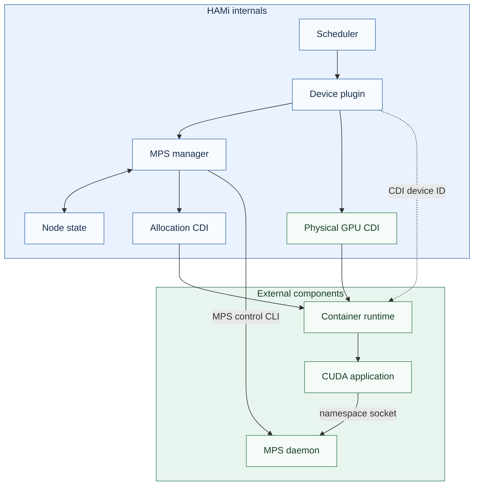
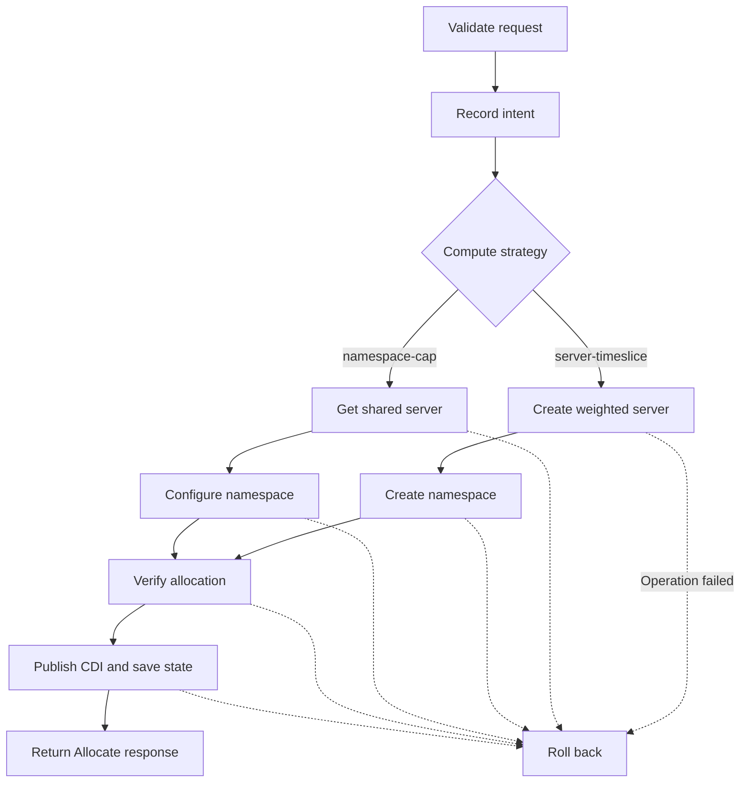

HAMi uses the NVIDIA Container Toolkit's `apply-cuda-memory-limits` CDI hook for GPU memory limits and MPS v3 for compute sharing. The backend requires driver r620 or later and validates its command interface against a dedicated daemon. See the [user guide](../userguide/nvidia-device/mps-v3.md) for prerequisites and workload examples.

## Architecture

The scheduler matches the node strategy and accounts for each GPU. The device plugin reads allocation annotations, and the MPS manager checks resource ownership and records allocation intent and completion on the node. HAMi generates the allocation CDI with a read-only socket mount and environment variables for routing and memory. The container runtime applies its mount and environment edits, and the CUDA client connects to the NVIDIA MPS namespace through the mounted socket. The device plugin uses NVIDIA Container Toolkit libraries to generate and publish the physical GPU CDI. The runtime invokes the memory hook specified in that CDI.

## Scheduling contract

The plugin reports `mps-v3`, the configured compute strategy, SM geometry, and allocated GPU sets. The scheduler matches `hami.io/mps-compute-mode` against the reported strategy, with `namespace-cap` as the Pod default. Both strategies use the existing per-GPU 100-unit compute budget and quota accounting. When core parsing returns zero, the backend charges 100 units for a percentage or timeslice request.

| Strategy | Server identity | Runtime provisioning |
| --- | --- | --- |
| `namespace-cap` | Sorted GPU UUID set | One namespace per Pod UID and container name. HAMi sets its active-thread percentage or assigns a static SM partition on every GPU. |
| `server-timeslice` | Pod UID, container name, and sorted GPU UUID set | One server per GPU container. HAMi programs and reads back `timeslice-pct` before the container starts and sets the namespace percentage to 100. |

Each container uses the same memory and compute allocation on every requested GPU. Identical GPU sets can share a server in `namespace-cap` and can have independent servers in `server-timeslice`. Partial overlaps are rejected by scheduling and checked again by the manager. Percentage and static SM provisioning cannot share a GPU.

Static partition accounting uses the base SM count. Before creating static partitions, the manager checks the driver-reported total SMs and chunks against the scheduler geometry. The scheduler charges `ceil(base SMs / total SMs × 100)`. If lending or borrowing is enabled, the base must consist of whole chunks. The finite maximum must cover the base and fit the GPU. The driver's runtime borrowing decisions do not change scheduler reservations.

## Allocation and runtime

### Allocation flow

1. Resolve the GPU set and check the allocation's strategy, memory, and compute settings. Check that any server to be reused has recorded ownership.
2. Persist the allocation intent with stable resource names before creating any resources.
3. Create or reuse the server. Set the weight for a new timeslice server before creating the namespace. For static SM requests, create each GPU's partition and bind it to the namespace using a separate `namespace set --device=<uuid> --sm-partition=<name>` operation.
4. Check the server's GPU set, namespace percentage, timeslice weight where applicable, and the socket. Read `sm-partitions` by GPU UUID and check the underlying partition configuration. Recovery checks base chunks, remainder, lending and borrowing parameters, and binding. Changes to effective SM capacity during borrowing are expected.
5. Publish the allocation's CDI entry and persist the completed state before returning the allocation. If any container in the request fails, roll back the resources newly created for that request.

The allocation-specific CDI entry supplies the read-only namespace socket mount, `CUDA_MPS_PIPE_DIRECTORY`, and integer MiB values for `NVIDIA_GPU_MEMORY_REQUEST` and `NVIDIA_GPU_MEMORY_LIMIT`. The physical GPU's CDI entry invokes the Toolkit hook during `createRuntime`. The namespace mount exposes only the allocated namespace. Static partition selection is handled by the server, which takes precedence over a client-provided partition identifier. [NVIDIA namespace assignments](https://docs.nvidia.com/deploy/mps/620/mpsv3-namespaces.html#sm-partition-assignments)

Compute routing uses the namespace socket. A future cgroup routing integration requires a Toolkit interface that can bind the real container cgroup before startup, refresh the mapping on restart, and remove it on exit. Startup must fail if that mapping fails, and the memory hook must still run. [NVIDIA cgroup matching](https://docs.nvidia.com/deploy/mps/620/mpsv3-namespaces.html#cgroup-matching)

## Daemon, recovery, and cleanup

The manager takes an exclusive lock on the dedicated state directory. It records the state version, Pod and container identity, GPU set, limits, SM options, resource names, and preparation status in `allocations.json`. It uses the node's Pod list to reconcile these records with the daemon.

On a drained daemon, the manager sets `compute-policy` and verifies the result. For `server-timeslice`, the plugin checks each GPU through NVML and makes only GPUs in `DEFAULT` compute mode eligible. The manager validates the actual GPU set when creating a workload server. If yield was previously set and the desired value is omitted, the manager restarts the drained daemon to restore the driver default. With live allocations it checks the existing policy and weights. Driver policy cannot be changed while a server exists, and a server weight cannot be changed while it has clients. [NVIDIA weighted timeslicing](https://docs.nvidia.com/deploy/mps/620/mpsv3-interface.html#weighted-timeslicing)

Health and recovery use individual `get` fields for configuration and use r620 CSV inventories to establish resource presence and check static partition attributes. The 620.70.06 `sm-partition list --all` CSV includes a contract timeout field before status. An unknown format, query timeout, or disconnect stops the affected operation with its state preserved. Daemon or global policy failures mark all GPUs unhealthy. An allocation health check failure affects only the GPUs in that allocation. Read-only health checks run outside the allocation locks.

Recovery reuses valid resources for live Pods. A live allocation from the old state format, an incompatible compute strategy, or a lost daemon with live allocations blocks startup. When the daemon survives, a manager restart can reconnect and validate the existing allocation. If a plugin container restart also stops the daemon, affected workloads require recovery.

Reclamation deletes the namespace without force, deletes its partitions, deletes the server once it has no remaining allocations, then removes the allocation's CDI entry and state. r620 refuses namespace deletion while clients are attached. Failed cleanup retains its record for retry. Normal container restarts keep their allocation because kubelet can reuse its Allocate response.
