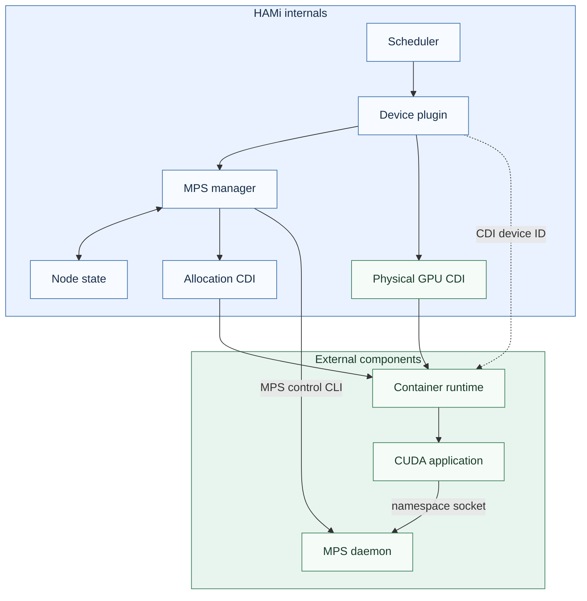
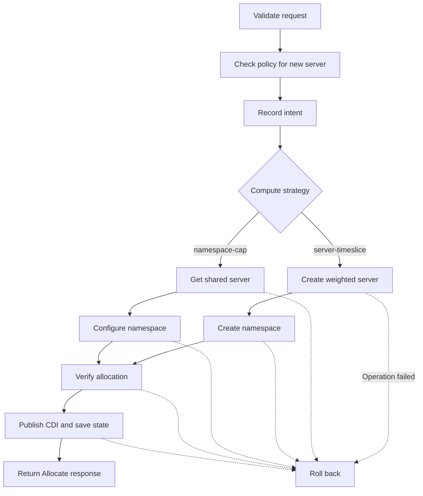

HAMi uses the NVIDIA Container Toolkit's `apply-cuda-memory-limits` CDI hook for GPU memory limits and MPS v3 for compute sharing. The backend currently supports only the r620 driver branch. See the [user guide](../userguide/nvidia-device/mps-v3.md) for prerequisites and workload examples.

## Architecture

The scheduler matches the node strategy and accounts for each GPU. The device plugin reads allocation annotations, and the MPS manager checks resource ownership and records allocation intent and completion on the node. HAMi generates the allocation CDI with a read-only socket mount and environment variables for routing and memory. The container runtime applies its mount and environment edits, and the CUDA client connects to the NVIDIA MPS namespace through the mounted socket. The device plugin uses NVIDIA Container Toolkit libraries to generate and publish the physical GPU CDI. The runtime invokes the memory hook specified in that CDI.

## Scheduling contract

In `mps-v3` mode, the plugin serializes device information directly to preserve `CustomInfo` containing the compute strategy, SM geometry, and allocated GPU set. The scheduler retains each container’s GPU set alongside the Pod’s aggregate usage. The scheduler matches `hami.io/mps-compute-mode` against the reported strategy, with `namespace-cap` as the Pod default. Both strategies use the existing per-GPU 100-unit compute budget and quota accounting. When core parsing returns zero, the backend charges 100 units for a percentage or timeslice request.

| Strategy | Server identity | Runtime provisioning |
| --- | --- | --- |
| `namespace-cap` | Sorted GPU UUID set | One namespace per Pod UID and container name. HAMi sets its active-thread percentage or assigns a static SM partition on every GPU. |
| `server-timeslice` | Pod UID, container name, and sorted GPU UUID set | One server per GPU container. HAMi programs and reads back `timeslice-pct` before the container starts and sets the namespace percentage to 100. |

Each container uses the same memory and compute allocation on every requested GPU. Identical GPU sets can share a server in `namespace-cap` and can have independent servers in `server-timeslice`. Partial overlaps are rejected by scheduling and checked again by the manager. Percentage and static SM provisioning cannot share a GPU.

Static partition accounting uses the base SM count. Before creating static partitions, the manager checks the driver-reported total SMs and chunks against the scheduler geometry. The scheduler charges `ceil(base SMs / total SMs × 100)`. If lending or borrowing is enabled, the base must consist of whole chunks. The finite maximum must cover the base and fit the GPU. The driver's runtime borrowing decisions do not change scheduler reservations.

## Allocation and runtime

### Allocation flow

1. Resolve the GPU set and check the allocation's strategy, memory, and compute settings. Check that any server to be reused has recorded ownership.
2. If the allocation requires a new server, check the daemon compute policy first. Persist the allocation intent with stable resource names before creating allocation resources.
3. Create or reuse the server. Set the weight for a new timeslice server before creating the namespace. For static SM requests, create each GPU's partition and bind it to the namespace using a separate `namespace set --device=<uuid> --sm-partition=<name>` operation.
4. Check the server's GPU set, namespace percentage, timeslice weight where applicable, and the socket. Read `sm-partitions` by GPU UUID and check the underlying partition configuration. Recovery checks base chunks, remainder, lending and borrowing parameters, and binding. Changes to effective SM capacity during borrowing are expected.
5. Publish the allocation's CDI entry and persist the completed state before returning the allocation. If any container in the request fails, roll back the resources newly created for that request.

The allocation-specific CDI entry supplies the read-only namespace socket mount, `CUDA_MPS_PIPE_DIRECTORY`, and integer MiB values for `NVIDIA_GPU_MEMORY_REQUEST` and `NVIDIA_GPU_MEMORY_LIMIT`. The physical GPU's CDI entry invokes the Toolkit hook during `createRuntime`. The namespace mount exposes only the allocated namespace. For each GPU, the namespace’s SM partition assignment takes precedence over the client’s `CUDA_MPS_SM_PARTITION` setting. [NVIDIA namespace assignments](https://docs.nvidia.com/deploy/mps/620/mpsv3-namespaces.html#sm-partition-assignments)

Compute routing uses the namespace socket. A future cgroup routing integration requires a Toolkit interface that can bind the real container cgroup before startup, refresh the mapping on restart, and remove it on exit. Startup must fail if that mapping fails, and the memory hook must still run. [NVIDIA cgroup matching](https://docs.nvidia.com/deploy/mps/620/mpsv3-namespaces.html#cgroup-matching)

The memory environment variables supply values to the hook. At container creation, Toolkit reads the OCI configuration, resolves the container's cgroup and applies the GPU memory limits by UUID through NVML. At startup HAMi verifies that the physical GPU CDI entries include this hook. The webhook rejects explicit `CUDA_MPS_*` and `NVIDIA_GPU_MEMORY_*` environment variables on GPU containers that explicitly select MPS v3. Allocation also checks the explicit environment.

Management commands use the r620 v3 interface. Static partitions use v3 chunk sizes and explicitly request any remainder. The namespace binds a partition by name for each GPU. Both protocols use `CUDA_MPS_PIPE_DIRECTORY`, and in v3 it can select the namespace socket directory directly. [NVIDIA static partitioning](https://docs.nvidia.com/deploy/mps/620/when-to-use-mps.html#static-sm-partitioning) · [NVIDIA namespace routing](https://docs.nvidia.com/deploy/mps/620/mpsv3-namespaces.html#namespace-routing)

## Daemon, recovery, and cleanup

The manager takes an exclusive lock on the dedicated state directory. It records the state version, Pod and container identity, GPU set, limits, SM options, resource names, and preparation status in `allocations.json`. It uses the node's Pod list to reconcile these records with the daemon.

The plugin checks the daemon compute policy at startup and again before creating a server. When the policy differs and the daemon has no servers, HAMi reapplies it and reads it back. A mismatch while a server exists rejects the new allocation. r620 accepts only `1` or `2` as explicit yield levels. To return to `unset`, drain the node and restart the external daemon with the yield setting omitted from its startup configuration. [NVIDIA weighted timeslicing](https://docs.nvidia.com/deploy/mps/620/mpsv3-interface.html#weighted-timeslicing)

In `namespace-cap`, the active-thread percentage limits attached CUDA client contexts, while scheduling accounts for the container. The plugin uses NVML to warn when the GPU is outside `EXCLUSIVE_PROCESS`. Exclusive mode blocks independent CUDA contexts while the MPS server holds the GPU. The plugin admits only `DEFAULT` GPUs for `server-timeslice`, whose weights apply to MPS servers. The node administrator sets GPU compute mode.

The reconciler attempts a pass every five seconds. A single read checks daemon liveness, with three consecutive failures marking MPS GPUs unhealthy. An individual allocation health failure affects only its GPUs. Device registration reads an immutable snapshot of successfully persisted allocations, so it can report GPU ownership while an allocation or cleanup command is in progress. Persisted intents and failed cleanups retain ownership in that snapshot.

Configuration checks use individual `get` fields where possible. Resource presence and static partition attributes still use r620 CSV inventories. The parser expects the 620.70.06 `sm-partition list --all` layout with the contract timeout column before status. An unknown layout fails the affected operation and preserves existing records.

At plugin startup, HAMi disables automatic UID server creation on the daemon’s main socket. An external daemon restart restores its startup settings. Configure `default_socket = "off"` in the daemon TOML so this v2 compatibility route stays disabled across daemon restarts. [NVIDIA v3 configuration file](https://docs.nvidia.com/deploy/mps/620/mpsv3-configuration-file.html)

Recovery reuses valid resources for live Pods. An unknown state version, an incompatible compute strategy, or an unavailable daemon blocks startup. Missing or inconsistent resources for an individual allocation make its GPUs unhealthy and retain the allocation record. When the daemon survives, a manager restart can reconnect and validate the existing allocation. The host service owns the daemon lifecycle. If the host daemon restarts and an existing allocation loses its server, namespace, or SM partition, the next allocation health check marks the GPUs in that allocation unhealthy. Recover the affected workloads through Kubernetes.

The manager uses cached Pod state to identify cleanup candidates and confirms absence or termination with the API server before reclaiming a prepared allocation. It persists cleanup intent before deleting resources and clears the prepared flag once the namespace is gone. Reclamation deletes the namespace without force, deletes its partitions, deletes the server once it has no remaining allocations, then removes the allocation's CDI entry and state. r620 refuses namespace deletion while clients are attached. Failed cleanup retains its record for retry. Normal container restarts keep their allocation because kubelet can reuse its Allocate response.
