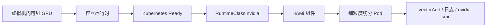
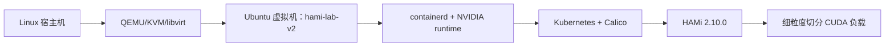
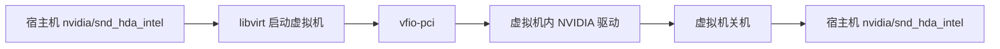
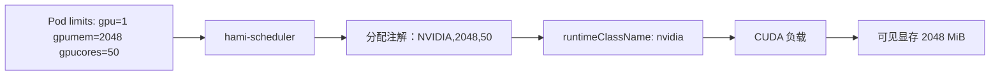

本实验在一台 Linux 工作站上搭建一套实测过的本地 HAMi GPU 直通环境。宿主机通过 QEMU/KVM/libvirt 运行一台 Ubuntu 虚拟机，再把一张 NVIDIA GPU 直通给它。Kubernetes、容器运行时、Calico、Helm 和 HAMi 都装在虚拟机里。宿主机桌面由另一块显卡（例如核显）负责显示。虚拟机关机后，NVIDIA GPU 会回到宿主机。

实验分阶段进行，每一层验证通过后再进入下一层。各层依次是：宿主机可行性检查、纯 CPU 虚拟机、qcow2 回滚、由 libvirt 管理的 PCI 直通、虚拟机内 NVIDIA 驱动、容器运行时 GPU 访问、kubeadm、Calico、普通 CUDA 负载、HAMi、细粒度切分负载和宿主机恢复。



:::note

本实验记录的是在一台工作站和一张 GPU 上实测可复现的步骤，不能作为通用的 VFIO/libvirt 排障指南。不同的笔记本、工作站、固件和 IOMMU 拓扑可能需要不同的处理。

:::

## 目的与测试环境

如果你想用真实的 NVIDIA GPU 测试 HAMi 的细粒度切分，又不想把 Kubernetes 和 HAMi 装在宿主机系统上，可以用本实验搭一套随时能重置的本地环境。

| 组件                 | 实测值                              |
| -------------------- | ----------------------------------- |
| 宿主机虚拟化栈       | QEMU/KVM、system libvirt、OVMF/UEFI |
| 虚拟机/domain 名称   | `hami-lab-v2`                       |
| 虚拟机操作系统       | Ubuntu 24.04.5 LTS                  |
| 虚拟机内核           | `6.8.0-142-generic`                 |
| GPU                  | NVIDIA GeForce RTX 3050 Laptop GPU  |
| GPU 显存             | 4096 MiB                            |
| 虚拟机内 NVIDIA 驱动 | 595.91.07                           |
| containerd           | 2.2.1                               |
| NVIDIA Toolkit       | 1.20.1                              |
| Kubernetes           | v1.36.5                             |
| Calico               | v3.32.2                             |
| V2 实测 Pod CIDR     | `192.168.0.0/16`                    |
| Helm                 | v3.22.0                             |
| HAMi chart/app       | 2.10.0                              |
| RuntimeClass         | `nvidia`                            |
| GPU 节点标签         | `gpu=on`                            |

把 GPU 和相关软件都放进虚拟机，是为了让宿主机随时能恢复原状。宿主机只运行 libvirt，并保存 qcow2 基础磁盘。NVIDIA 驱动、容器运行时、Kubernetes、Calico 和 HAMi 都装在 Ubuntu 虚拟机里。如果虚拟机里的实验出了问题，直接丢弃当前的 qcow2 overlay 即可，基础磁盘不受影响。



## 设置本地变量

在执行相关步骤的 shell 里先设置这些变量。只在宿主机上用的变量供 libvirt 和磁盘命令使用，`GUEST_IP` 和 `POD_CIDR` 在虚拟机里配置 kubeadm 和 Calico 时也要用到。命令里使用变量是为了方便复制，输出块里显示的是测试环境中的实际值。

```bash
export DOMAIN=hami-lab-v2
export GUEST_USER=ubuntu # replace with your VM user
export GUEST_IP=192.168.122.242 # replace with your VM IP
export POD_CIDR=10.244.0.0/16
export ISO="$HOME/Downloads/ubuntu-24.04.5-live-server-amd64.iso"
export BASE=/var/lib/libvirt/images/hami-lab-v2-base.qcow2
export WORK=/var/lib/libvirt/images/hami-lab-v2-work.qcow2
```

完整的 GPU 和 HAMi 测试使用的是 V2 集群的 `192.168.0.0/16` Pod CIDR。这个网段包含了 libvirt 默认网络 `192.168.122.0/24`。后来补做进程路径测试时，Calico 把发往 libvirt DNS 服务器的流量当成了地址池内部流量，没有按常规做出向 masquerade，结果 CoreDNS 向 `192.168.122.1:53` 转发外部 DNS 查询时超时。

上面的变量使用不与之重叠的 `10.244.0.0/16`。这个网段单独验证过：在 Kubernetes v1.36.5 和 Calico v3.32.2 下，CoreDNS 保持默认转发配置，集群内外的 DNS 解析都正常，Pod 也能正常访问外部 HTTPS。这次验证没有重跑 GPU 和 HAMi 负载测试，所以下文 GPU 和 HAMi 相关的输出仍来自最初使用 `192.168.0.0/16` 的那次运行。

## 宿主机可行性检查

先在宿主机上做只读检查，这一步还不要分离 GPU。

在宿主机上运行：

```bash
lscpu | awk -F: '/Model name|Virtualization/ {gsub(/^[[:space:]]+/, "", $2); print $1 ": " $2}'
test -e /dev/kvm && echo "/dev/kvm present"
virsh -c qemu:///system dominfo "$DOMAIN" >/dev/null 2>&1 || \
  echo "$DOMAIN domain name is free"
```

测试宿主机上的输出：

```text
Model name: AMD Ryzen 5 5600H with Radeon Graphics
Virtualization: AMD-V
/dev/kvm present
hami-lab-v2 domain name is free
```

检查虚拟化工具和安装介质：

```bash
qemu-system-x86_64 --version
qemu-img --version
virt-install --version
ls /usr/share/edk2/x64/OVMF_CODE.4m.fd
test -f "$ISO" && echo "Ubuntu ISO is present"
```

测试宿主机上的输出：

```text
QEMU emulator version 11.1.1
qemu-img version 11.1.1
virt-install version 5.1.0
/usr/share/edk2/x64/OVMF_CODE.4m.fd
Ubuntu ISO is present
```

找到 GPU 及其音频功能，并列出 GPU 所在 IOMMU 组里的所有设备：

```bash
GPU_GROUP="$(basename "$(readlink /sys/bus/pci/devices/0000:01:00.0/iommu_group)")"
printf 'GPU IOMMU group: %s\n' "$GPU_GROUP"
for dev in /sys/kernel/iommu_groups/"$GPU_GROUP"/devices/*; do
  pci="${dev##*/}"
  printf '%s ' "$pci"
  lspci -nn -s "${pci#0000:}"
  lspci -nnk -s "${pci#0000:}" | awk '/Kernel driver in use/ {print "  " $0}'
done
```

测试宿主机上的输出：

```text
GPU IOMMU group: 11
0000:01:00.0 01:00.0 VGA compatible controller [0300]: NVIDIA Corporation GA107M [GeForce RTX 3050 Mobile] [10de:25a2]
    Kernel driver in use: nvidia
0000:01:00.1 01:00.1 Audio device [0403]: NVIDIA Corporation GA107 High Definition Audio Controller [10de:2291]
    Kernel driver in use: snd_hda_intel
```

确认宿主机桌面的显示不依赖 NVIDIA GPU：

```bash
echo "$XDG_SESSION_TYPE"
echo "$XDG_CURRENT_DESKTOP"
for node in /sys/class/drm/card*-*; do
  printf '%s ' "$(basename "$node")"
  cat "$node/status"
done
glxinfo -B | grep -E 'OpenGL vendor|OpenGL renderer'
```

测试宿主机上的输出：

```text
wayland
niri
card0-HDMI-A-1 disconnected
card2-DP-1 disconnected
card2-eDP-1 connected
OpenGL vendor: AMD
OpenGL renderer: AMD Radeon Graphics
```

检查点：同一个 IOMMU 组里的设备会被一起直通给虚拟机。只有列出的每个设备都能安全地从宿主机上分离，并且宿主机还有另一块显卡负责显示，才继续下一步。

## 创建全新虚拟机与 qcow2 回滚边界

先创建一台不带 GPU 的虚拟机，在加入直通之前确认它能正常启动、SSH 登录和关机。

创建一个全新的基础磁盘：

```bash
sudo qemu-img create -f qcow2 \
  "$BASE" \
  50G
```

输出：

```text
Formatting '/var/lib/libvirt/images/hami-lab-v2-base.qcow2', fmt=qcow2 cluster_size=65536 extended_l2=off compression_type=zlib size=53687091200 lazy_refcounts=off refcount_bits=16
```

创建纯 CPU 的 Ubuntu 虚拟机：

```bash
sudo virt-install \
  --connect qemu:///system \
  --name "$DOMAIN" \
  --memory 8192 \
  --vcpus 4 \
  --cpu host-passthrough \
  --machine q35 \
  --boot uefi \
  --disk path="$BASE",format=qcow2,bus=virtio \
  --cdrom "$ISO" \
  --os-variant ubuntu24.04 \
  --network network=default,model=virtio \
  --graphics spice \
  --video virtio \
  --console pty,target_type=serial \
  --autoconsole graphical
```

在打开的图形控制台中完成 Ubuntu Server 24.04.5 LTS 的安装。因为指定了 `--graphics spice`，这个控制台走的是 SPICE。安装过程中勾选 OpenSSH，然后验证虚拟机：

```bash
ssh "${GUEST_USER}@${GUEST_IP}" \
  'hostnamectl --static; lsb_release -ds; uname -r; systemctl is-active ssh'
```

输出：

```text
hami-lab-v2
Ubuntu 24.04.5 LTS
6.8.0-142-generic
active
```

修改磁盘链之前，先关闭虚拟机：

```bash
ssh "${GUEST_USER}@${GUEST_IP}" 'sudo poweroff'
for attempt in $(seq 1 60); do
  DOMAIN_STATE="$(virsh -c qemu:///system domstate "$DOMAIN")"
  [ "$DOMAIN_STATE" = "shut off" ] && break
  sleep 2
done
[ "$DOMAIN_STATE" = "shut off" ] || {
  echo "Refusing disk changes: $DOMAIN did not shut off within 120 seconds" >&2
  exit 1
}
printf '%s\n' "$DOMAIN_STATE"
```

输出：

```text
shut off
```

基于已安装好的基础磁盘，创建一个可随时丢弃的工作 overlay：

```bash
sudo qemu-img create -f qcow2 -F qcow2 -b "$BASE" "$WORK"
qemu-img info --backing-chain "$WORK"
```

输出：

```text
Formatting '/var/lib/libvirt/images/hami-lab-v2-work.qcow2', fmt=qcow2 cluster_size=65536 extended_l2=off compression_type=zlib size=53687091200 backing_file=/var/lib/libvirt/images/hami-lab-v2-base.qcow2 backing_fmt=qcow2 lazy_refcounts=off refcount_bits=16
backing file: /var/lib/libvirt/images/hami-lab-v2-base.qcow2
backing file format: qcow2
corrupt: false
```

在虚拟机关机的状态下，把它的磁盘从基础磁盘换成 overlay：

```bash
DOMAIN_STATE="$(virsh -c qemu:///system domstate "$DOMAIN")"
printf '%s\n' "$DOMAIN_STATE"
[ "$DOMAIN_STATE" = "shut off" ] || {
  echo "Refusing disk changes: $DOMAIN is $DOMAIN_STATE" >&2
  exit 1
}
virsh -c qemu:///system dumpxml "$DOMAIN" > hami-lab-v2-before-overlay.xml
virsh -c qemu:///system detach-disk "$DOMAIN" vda --config
virsh -c qemu:///system attach-disk "$DOMAIN" "$WORK" vda \
  --config \
  --type disk \
  --driver qemu \
  --subdriver qcow2 \
  --targetbus virtio
virsh -c qemu:///system domblklist "$DOMAIN"
```

输出：

```text
shut off
Device detached successfully
Device attached successfully
Target   Source
vda      /var/lib/libvirt/images/hami-lab-v2-work.qcow2
sda      -
```

用 overlay 启动虚拟机：

```bash
virsh -c qemu:///system start "$DOMAIN"
virsh -c qemu:///system domstate "$DOMAIN"
virsh -c qemu:///system domblklist "$DOMAIN"
```

输出：

```text
Domain 'hami-lab-v2' started
running
vda      /var/lib/libvirt/images/hami-lab-v2-work.qcow2
sda      -
```

在虚拟机里创建一个标记文件，它会写进 overlay：

```bash
ssh "${GUEST_USER}@${GUEST_IP}" \
  'cat > ~/v2-rollback-marker.txt <<EOF
V2 rollback marker
created_utc=2026-09-30T11:35:18Z
hostname=hami-lab-v2
disk_expected=hami-lab-v2-work.qcow2
EOF
cat ~/v2-rollback-marker.txt'
```

输出：

```text
V2 rollback marker
created_utc=2026-09-30T11:35:18Z
hostname=hami-lab-v2
disk_expected=hami-lab-v2-work.qcow2
```

关闭虚拟机，等 libvirt 报告 `shut off` 之后再操作 overlay：

```bash
ssh "${GUEST_USER}@${GUEST_IP}" 'sudo poweroff'
for attempt in $(seq 1 60); do
  DOMAIN_STATE="$(virsh -c qemu:///system domstate "$DOMAIN")"
  [ "$DOMAIN_STATE" = "shut off" ] && break
  sleep 2
done
[ "$DOMAIN_STATE" = "shut off" ] || {
  echo "Refusing overlay reset: $DOMAIN did not shut off within 120 seconds" >&2
  exit 1
}
printf '%s\n' "$DOMAIN_STATE"
```

输出：

```text
shut off
```

把旧的 overlay 移到一边，在原来的路径上重新创建一个干净的 overlay：

```bash
sudo mv "$WORK" /var/lib/libvirt/images/hami-lab-v2-work-with-marker.qcow2
sudo qemu-img create -f qcow2 -F qcow2 -b "$BASE" "$WORK"
qemu-img info --backing-chain "$WORK"
virsh -c qemu:///system domblklist "$DOMAIN"
```

输出：

```text
Formatting '/var/lib/libvirt/images/hami-lab-v2-work.qcow2', fmt=qcow2 cluster_size=65536 extended_l2=off compression_type=zlib size=53687091200 backing_file=/var/lib/libvirt/images/hami-lab-v2-base.qcow2 backing_fmt=qcow2 lazy_refcounts=off refcount_bits=16
backing file: /var/lib/libvirt/images/hami-lab-v2-base.qcow2
vda      /var/lib/libvirt/images/hami-lab-v2-work.qcow2
```

用干净的 overlay 启动，确认标记文件已经不存在：

```bash
virsh -c qemu:///system start "$DOMAIN"
ssh "${GUEST_USER}@${GUEST_IP}" \
  'test ! -e ~/v2-rollback-marker.txt && echo "PASS: marker is absent after overlay reset"'
```

输出：

```text
Domain 'hami-lab-v2' started
PASS: marker is absent after overlay reset
```

检查点：确认回滚可用后再继续。有了这一步，后面对 Kubernetes 和 HAMi 的改动随时都能丢弃。

## 使用 virsh 直通 RTX 的 VGA 和 HDA 设备

本实验直通两个 PCI 功能：RTX 的 VGA 功能 `0000:01:00.0` 和它的 HDA 音频功能 `0000:01:00.1`。虚拟机关机时，它们由宿主机驱动使用。设置 `managed='yes'` 后，libvirt 会在虚拟机启动时把它们切换到 `vfio-pci`，关机时再还给宿主机驱动。



启动直通虚拟机之前，先停掉宿主机上占用这张卡的服务。风扇控制服务因机器而异，不在下面的通用步骤里。如果你的宿主机需要手动停掉某个这类服务，请记下它的 unit 名称，在确认宿主机恢复之前把它重新启动并检查运行正常。

```bash
systemctl --user stop pipewire-pulse.service pipewire-pulse.socket pipewire.service pipewire.socket wireplumber.service
sudo systemctl stop nvidia-persistenced

for unit in pipewire.socket pipewire.service pipewire-pulse.socket pipewire-pulse.service wireplumber.service; do
  printf '%s ' "$unit"
  systemctl --user is-active "$unit" || true
done
printf 'nvidia-persistenced '
systemctl is-active nvidia-persistenced || true
```

测试宿主机上观察到的输出：

```text
pipewire.socket inactive
pipewire.service inactive
pipewire-pulse.socket inactive
pipewire-pulse.service inactive
wireplumber.service inactive
nvidia-persistenced inactive
```

测试用的笔记本上还停掉了这台机器特有的 `nbfc_service` 风扇控制服务，并确认它是 inactive。这只是这台机器的情况，其他系统不需要这一步。

创建 GPU 和音频的 hostdev XML 文件，然后在虚拟机关机的状态下把它们加到虚拟机配置里。仓库中的 [`rtx-gpu.xml`](https://github.com/Project-HAMi/website/blob/master/tutorials/labs/examples/20-local-gpu-passthrough/libvirt/rtx-gpu.xml) 和 [`rtx-audio.xml`](https://github.com/Project-HAMi/website/blob/master/tutorials/labs/examples/20-local-gpu-passthrough/libvirt/rtx-audio.xml) 是同样的内容，可供参考。

```bash
cat >rtx-gpu.xml <<'EOF'
<hostdev mode='subsystem' type='pci' managed='yes'>
  <source>
    <address domain='0x0000' bus='0x01' slot='0x00' function='0x0'/>
  </source>
</hostdev>
EOF

cat >rtx-audio.xml <<'EOF'
<hostdev mode='subsystem' type='pci' managed='yes'>
  <source>
    <address domain='0x0000' bus='0x01' slot='0x00' function='0x1'/>
  </source>
</hostdev>
EOF

virsh -c qemu:///system domstate "$DOMAIN"
virsh -c qemu:///system attach-device "$DOMAIN" ./rtx-gpu.xml --config
virsh -c qemu:///system attach-device "$DOMAIN" ./rtx-audio.xml --config
```

输出：

```text
shut off
Device attached successfully
Device attached successfully
```

启动虚拟机，在宿主机上查看这两个设备当前使用的驱动：

```bash
virsh -c qemu:///system start "$DOMAIN"
lspci -nnk -s 01:00.0 | grep 'Kernel driver in use'
lspci -nnk -s 01:00.1 | grep 'Kernel driver in use'
nvidia-smi
```

输出：

```text
Domain 'hami-lab-v2' started
Kernel driver in use: vfio-pci
Kernel driver in use: vfio-pci
Failed to initialize NVML: No supported GPUs were found
```

在虚拟机内确认可以看到这两个 PCI 设备：

```bash
ssh "${GUEST_USER}@${GUEST_IP}" \
  "lspci -nnk | grep -A3 -E '07:00.0|08:00.0'"
```

输出：

```text
07:00.0 VGA compatible controller [0300]: NVIDIA Corporation GA107M [GeForce RTX 3050 Mobile] [10de:25a2]
  Kernel driver in use: nouveau
08:00.0 Audio device [0403]: NVIDIA Corporation Device [10de:2291]
  Kernel driver in use: snd_hda_intel
```

检查点：虚拟机里必须能看到这两个 NVIDIA PCI 功能，然后再安装 NVIDIA 驱动。

## 验证虚拟机内的 NVIDIA 驱动

在虚拟机内查看推荐的驱动并安装：

```bash
ubuntu-drivers devices | grep recommended
sudo apt-get update
sudo DEBIAN_FRONTEND=noninteractive apt-get install -y nvidia-driver-595-open
sudo reboot
```

输出：

```text
recommended: nvidia-driver-595-open
nvidia-driver-595-open 595.91.07-0ubuntu0.24.04.1 installed
```

重启后，验证虚拟机内的驱动：

```bash
nvidia-smi --query-gpu=name,driver_version,memory.total --format=csv,noheader
```

输出：

```text
NVIDIA GeForce RTX 3050 Laptop GPU, 595.91.07, 4096 MiB
```

检查虚拟机里 GPU 绑定的驱动：

```bash
lspci -nnk -s 07:00.0 | grep 'Kernel driver in use'
lsmod | grep -E '^nvidia|^nouveau' || true
```

输出：

```text
Kernel driver in use: nvidia
nvidia_uvm
nvidia_drm
nvidia_modeset
nvidia
```

检查点：虚拟机里的 `nvidia-smi` 能正常工作后，再开始配置容器运行时。

## 验证 containerd 与 NVIDIA Container Toolkit

在虚拟机内安装 containerd、runc 和 NVIDIA Container Toolkit。测试使用的软件包版本为 containerd `2.2.1-0ubuntu1~24.04.3`、runc `1.3.4-0ubuntu1~24.04.1` 和 NVIDIA Container Toolkit `1.20.1-1`。

先安装软件包，再配置运行时：

```bash
sudo apt-get update
sudo apt-get install -y ca-certificates curl gpg

curl -fsSL https://nvidia.github.io/libnvidia-container/gpgkey |
  sudo gpg --dearmor -o /usr/share/keyrings/nvidia-container-toolkit-keyring.gpg
curl -fsSL https://nvidia.github.io/libnvidia-container/stable/deb/nvidia-container-toolkit.list |
  sed 's#deb https://#deb [signed-by=/usr/share/keyrings/nvidia-container-toolkit-keyring.gpg] https://#g' |
  sudo tee /etc/apt/sources.list.d/nvidia-container-toolkit.list

sudo apt-get update
sudo apt-get install -y \
  containerd=2.2.1-0ubuntu1~24.04.3 \
  runc=1.3.4-0ubuntu1~24.04.1 \
  nvidia-container-toolkit=1.20.1-1
```

配置 NVIDIA 运行时，为 `runc` 和 `nvidia` 运行时 handler 都启用 systemd cgroup，然后重启 containerd：

```bash
sudo nvidia-ctk runtime configure --runtime=containerd
sudo sed -i 's/SystemdCgroup = false/SystemdCgroup = true/g' \
  /etc/containerd/config.toml \
  /etc/containerd/conf.d/99-nvidia.toml
sudo systemctl restart containerd
```

验证运行时版本和 cgroup 配置：

```bash
containerd --version
runc --version
nvidia-ctk --version
systemctl is-active containerd
grep -R 'SystemdCgroup = true' /etc/containerd/config.toml /etc/containerd/conf.d/99-nvidia.toml
```

输出：

```text
containerd github.com/containerd/containerd/v2 2.2.1
runc version 1.3.4-0ubuntu1~24.04.1
NVIDIA Container Toolkit CLI version 1.20.1
active
/etc/containerd/config.toml:            SystemdCgroup = true
/etc/containerd/conf.d/99-nvidia.toml:            SystemdCgroup = true
```

确认 NVIDIA 运行时的 drop-in 配置：

```bash
grep -R 'BinaryName.*nvidia-container-runtime' /etc/containerd
```

输出：

```text
BinaryName = "/usr/bin/nvidia-container-runtime"
```

在安装 Kubernetes 之前，先用普通容器做一次 GPU 冒烟测试：

```bash
sudo ctr run --rm --gpus 0 \
  docker.io/nvidia/cuda:12.4.1-base-ubuntu22.04 \
  hami-v2-nvidia-smi \
  nvidia-smi --query-gpu=name,memory.total --format=csv,noheader
```

输出：

```text
NVIDIA GeForce RTX 3050 Laptop GPU, 4096 MiB
```

检查点：在运行 kubeadm 之前，先确认虚拟机内的容器运行时可以访问 GPU。如果这一层有问题，装了 HAMi 也解决不了。

## 手动使用 kubeadm 初始化集群

为 Kubernetes 准备节点：

```bash
sudo swapoff -a
sudo sed -i.bak '/ swap /s/^/# kubeadm disabled: /' /etc/fstab
cat <<'EOF' | sudo tee /etc/modules-load.d/k8s.conf
overlay
br_netfilter
EOF
sudo modprobe overlay
sudo modprobe br_netfilter
cat <<'EOF' | sudo tee /etc/sysctl.d/k8s.conf
net.bridge.bridge-nf-call-iptables = 1
net.bridge.bridge-nf-call-ip6tables = 1
net.ipv4.ip_forward = 1
EOF
sudo sysctl --system
```

输出：

```text
net.bridge.bridge-nf-call-iptables = 1
net.bridge.bridge-nf-call-ip6tables = 1
net.ipv4.ip_forward = 1
```

从 v1.36 软件源安装 Kubernetes 软件包，并锁定版本：

```bash
sudo apt-get update
sudo apt-get install -y ca-certificates curl gpg apt-transport-https
sudo mkdir -p /etc/apt/keyrings
curl -fsSL https://pkgs.k8s.io/core:/stable:/v1.36/deb/Release.key |
  sudo gpg --dearmor -o /etc/apt/keyrings/kubernetes-apt-keyring.gpg
echo 'deb [signed-by=/etc/apt/keyrings/kubernetes-apt-keyring.gpg] https://pkgs.k8s.io/core:/stable:/v1.36/deb/ /' |
  sudo tee /etc/apt/sources.list.d/kubernetes.list
sudo apt-get update
sudo apt-get install -y kubeadm=1.36.5-1.1 kubelet=1.36.5-1.1 kubectl=1.36.5-1.1 cri-tools=1.36.0-1.1
sudo apt-mark hold kubeadm kubelet kubectl
kubeadm version -o short
kubelet --version
kubectl version --client -o jsonpath='{.clientVersion.gitVersion}{"\n"}'
```

输出：

```text
kubeadm: v1.36.5
kubelet: Kubernetes v1.36.5
kubectl client gitVersion: v1.36.5
```

让 `crictl` 指向 containerd：

```bash
cat <<'EOF' | sudo tee /etc/crictl.yaml
runtime-endpoint: unix:///run/containerd/containerd.sock
image-endpoint: unix:///run/containerd/containerd.sock
timeout: 10
debug: false
pull-image-on-create: false
EOF
sudo crictl info | grep -E 'RuntimeName|RuntimeVersion|RuntimeApiVersion'
```

输出：

```text
RuntimeName: containerd
RuntimeVersion: 2.2.1
RuntimeApiVersion: v1
```

初始化控制面：

```bash
sudo kubeadm init \
  --kubernetes-version v1.36.5 \
  --apiserver-advertise-address "${GUEST_IP}" \
  --pod-network-cidr "${POD_CIDR}" \
  --cri-socket unix:///run/containerd/containerd.sock
```

输出：

```text
Your Kubernetes control-plane has initialized successfully!
```

为虚拟机内的用户配置 kubectl：

```bash
mkdir -p "$HOME/.kube"
sudo cp /etc/kubernetes/admin.conf "$HOME/.kube/config"
sudo chown "$(id -u):$(id -g)" "$HOME/.kube/config"
kubectl get nodes -o wide
```

输出：

```text
NAME          STATUS     ROLES           VERSION   INTERNAL-IP       OS-IMAGE
hami-lab-v2   NotReady   control-plane   v1.36.5   192.168.122.242   Ubuntu 24.04.5 LTS
```

查看节点尚未就绪的原因：

```bash
kubectl describe node hami-lab-v2 | grep -A2 'KubeletNotReady'
```

输出：

```text
KubeletNotReady: container runtime network not ready
NetworkPluginNotReady: cni plugin not initialized
```

检查点：安装 CNI 之前出现 `NotReady` 是正常的。只有当控制面 Pod 都在运行，并且 `/livez` 和 `/readyz` 检查通过时，才继续下一步。

## 手动安装 Calico

下载固定版本的 Calico 清单，并校验其 checksum：

```bash
CALICO_MANIFEST="$HOME/calico-v3.32.2.yaml"
curl -L \
  https://raw.githubusercontent.com/projectcalico/calico/v3.32.2/manifests/calico.yaml \
  -o "$CALICO_MANIFEST"
(cd "$HOME" && printf '%s  %s\n' \
  'a8c828a06a87c629a282ebbc424895b77f3a030251993e41ea400a743675bb02' \
  'calico-v3.32.2.yaml' | sha256sum -c -)
```

输出：

```text
calico-v3.32.2.yaml: OK
```

把 Calico 的 IPv4 地址池设置为与 kubeadm 相同的 Pod CIDR。上游清单里这一项默认被注释掉了，显式设置可以让 kubeadm 和 Calico 的配置保持一致。

```bash
python3 - "$POD_CIDR" <<'PY'
from pathlib import Path
import re
import sys

cidr = sys.argv[1]
path = Path.home() / "calico-v3.32.2.yaml"
text = path.read_text()
new = f'''            - name: CALICO_IPV4POOL_CIDR
              value: "{cidr}"
'''
text, count = re.subn(
    r'(?m)^            # - name: CALICO_IPV4POOL_CIDR\n            #   value: "[^"]+"\n',
    new,
    text,
    count=1,
)
if count != 1:
    raise SystemExit("CALICO_IPV4POOL_CIDR block not found")
path.write_text(text)
PY
```

应用之前先对清单做一次 dry-run：

```bash
kubectl apply --dry-run=server -f "$CALICO_MANIFEST"
```

输出：

```text
daemonset.apps/calico-node created (server dry run)
deployment.apps/calico-kube-controllers created (server dry run)
```

应用 Calico：

```bash
kubectl apply -f "$CALICO_MANIFEST"
kubectl -n kube-system rollout status daemonset/calico-node --timeout=5m
kubectl -n kube-system rollout status deployment/calico-kube-controllers --timeout=5m
kubectl wait node hami-lab-v2 --for=condition=Ready --timeout=5m
```

输出：

```text
daemonset/calico-node successfully rolled out
deployment/calico-kube-controllers successfully rolled out
node/hami-lab-v2 condition met
```

查看集群状态：

```bash
kubectl get nodes
kubectl -n kube-system get pods
```

输出：

```text
NAME          STATUS   ROLES           VERSION
hami-lab-v2   Ready    control-plane   v1.36.5

calico-kube-controllers   1/1 Running
calico-node               1/1 Running
coredns                   1/1 Running
etcd-hami-lab-v2          1/1 Running
kube-apiserver-hami-lab-v2 1/1 Running
kube-controller-manager   1/1 Running
kube-proxy                1/1 Running
kube-scheduler-hami-lab-v2 1/1 Running
```

用一个临时 Pod 验证 DNS，这个集群只有一个控制面节点，所以要加上 toleration：

```bash
kubectl run v2-calico-dns-smoke \
  --image=busybox:1.36.1 \
  --restart=Never \
  --overrides='{"spec":{"tolerations":[{"key":"node-role.kubernetes.io/control-plane","operator":"Exists","effect":"NoSchedule"}]}}' \
  -- nslookup kubernetes.default.svc.cluster.local
kubectl logs v2-calico-dns-smoke
kubectl delete pod v2-calico-dns-smoke
```

输出：

```text
Server: 10.96.0.10
Name: kubernetes.default.svc.cluster.local
Address: 10.96.0.1
pod "v2-calico-dns-smoke" deleted
```

检查点：节点就绪、Calico、CoreDNS、API 健康检查和虚拟机内的 GPU 可见性都必须通过，之后才能运行 GPU 负载。

## 安装 HAMi 之前运行普通 CUDA 负载

为 containerd 中名为 `nvidia` 的运行时 handler 创建 `RuntimeClass`：

```bash
kubectl apply -f - <<'EOF'
apiVersion: node.k8s.io/v1
kind: RuntimeClass
metadata:
  name: nvidia
handler: nvidia
EOF
kubectl get runtimeclass nvidia -o custom-columns='NAME:.metadata.name,HANDLER:.handler'
```

输出：

```text
runtimeclass.node.k8s.io/nvidia created
NAME     HANDLER
nvidia   nvidia
```

安装为本实验做过调整的 NVIDIA device plugin。镜像用的是官方的 `nvcr.io/nvidia/k8s-device-plugin:v0.20.1`，另外加了 `runtimeClassName: nvidia` 和针对控制面 taint 的 toleration：

```bash
kubectl apply -f - <<'EOF'
apiVersion: apps/v1
kind: DaemonSet
metadata:
  name: nvidia-device-plugin-daemonset
  namespace: kube-system
spec:
  selector:
    matchLabels:
      name: nvidia-device-plugin-ds
  template:
    metadata:
      labels:
        name: nvidia-device-plugin-ds
    spec:
      runtimeClassName: nvidia
      tolerations:
        - key: nvidia.com/gpu
          operator: Exists
          effect: NoSchedule
        - key: node-role.kubernetes.io/control-plane
          operator: Exists
          effect: NoSchedule
      containers:
        - image: nvcr.io/nvidia/k8s-device-plugin:v0.20.1
          name: nvidia-device-plugin-ctr
          securityContext:
            allowPrivilegeEscalation: false
            capabilities:
              drop: ["ALL"]
          volumeMounts:
            - name: device-plugin
              mountPath: /var/lib/kubelet/device-plugins
      volumes:
        - name: device-plugin
          hostPath:
            path: /var/lib/kubelet/device-plugins
EOF
kubectl -n kube-system rollout status daemonset/nvidia-device-plugin-daemonset --timeout=5m
```

输出：

```text
runtimeclass.node.k8s.io/nvidia unchanged
daemonset.apps/nvidia-device-plugin-daemonset created
daemon set "nvidia-device-plugin-daemonset" successfully rolled out
```

等待节点上报一张物理 GPU：

```bash
kubectl get node hami-lab-v2 \
  -o jsonpath='capacity={.status.capacity.nvidia\.com/gpu} allocatable={.status.allocatable.nvidia\.com/gpu}{"\n"}'
```

输出：

```text
capacity=1 allocatable=1
```

在安装 HAMi 之前运行一个普通的 CUDA 负载：

```bash
kubectl apply -f - <<'EOF'
apiVersion: v1
kind: Pod
metadata:
  name: v2-plain-cuda-vectoradd
spec:
  restartPolicy: Never
  runtimeClassName: nvidia
  tolerations:
    - key: node-role.kubernetes.io/control-plane
      operator: Exists
      effect: NoSchedule
  containers:
    - name: vectoradd
      image: nvcr.io/nvidia/k8s/cuda-sample:vectoradd-cuda12.5.0
      resources:
        limits:
          nvidia.com/gpu: 1
EOF
kubectl wait pod/v2-plain-cuda-vectoradd --for=jsonpath='{.status.phase}'=Succeeded --timeout=10m
kubectl logs v2-plain-cuda-vectoradd
```

输出：

```text
pod/v2-plain-cuda-vectoradd created
pod/v2-plain-cuda-vectoradd condition met
[Vector addition of 50000 elements]
Copy input data from the host memory to the CUDA device
CUDA kernel launch with 196 blocks of 256 threads
Copy output data from the CUDA device to the host memory
Test PASSED
Done
```

这说明在没有 HAMi 的情况下，Kubernetes、NVIDIA 运行时 handler 和官方 device plugin 都工作正常，这个结果还不涉及 HAMi。

安装 HAMi 之前，先移除官方 device plugin：

```bash
kubectl -n kube-system delete ds nvidia-device-plugin-daemonset --ignore-not-found
if kubectl -n kube-system get pod -l name=nvidia-device-plugin-ds --no-headers 2>/dev/null | grep -q .; then
  kubectl -n kube-system wait --for=delete pod \
    -l name=nvidia-device-plugin-ds --timeout=5m >/dev/null
fi
kubectl get runtimeclass nvidia
```

输出：

```text
daemonset.apps "nvidia-device-plugin-daemonset" deleted
NAME     HANDLER   AGE
nvidia   nvidia
```

## 检查 values 并使用 Helm 安装 HAMi

HAMi 需要用到前面创建的 `RuntimeClass`、`gpu=on` 节点标签，以及针对单节点控制面集群的 toleration。

给节点打标签：

```bash
kubectl label node hami-lab-v2 gpu=on
kubectl get node hami-lab-v2 -o jsonpath='gpu-label={.metadata.labels.gpu}{"\n"}'
```

输出：

```text
node/hami-lab-v2 labeled
gpu-label=on
```

安装 Helm 并添加 HAMi 仓库：

```bash
sudo apt-get update
sudo apt-get install -y apt-transport-https ca-certificates curl gpg
HELM_BUILDKITE_APT_KEY_ID="DDF78C3E6EBB2D2CC223C95C62BA89D07698DBC6"
curl -fsSL https://packages.buildkite.com/helm-linux/helm-debian/gpgkey -o /tmp/helm.gpgkey
gpg --show-keys --with-colons /tmp/helm.gpgkey |
  awk -F: '$1 == "fpr" { print $10 }' |
  grep -Fx "$HELM_BUILDKITE_APT_KEY_ID"
gpg --dearmor /tmp/helm.gpgkey |
  sudo tee /usr/share/keyrings/helm.gpg >/dev/null
echo "deb [signed-by=/usr/share/keyrings/helm.gpg] https://packages.buildkite.com/helm-linux/helm-debian/any/ any main" |
  sudo tee /etc/apt/sources.list.d/helm-stable-debian.list
sudo apt-get update
sudo apt-get install -y helm
helm version --short
helm repo add hami https://project-hami.github.io/HAMi
helm repo update
helm search repo hami/hami --versions | grep 2.10.0
```

输出：

```text
v3.22.0
"hami" has been added to your repositories
Update Complete. Happy Helming!
hami/hami 2.10.0 2.10.0
```

创建 `/tmp/hami-v2-values.yaml`。仓库中的 [`examples/20-local-gpu-passthrough/hami-values.yaml`](https://github.com/Project-HAMi/website/blob/master/tutorials/labs/examples/20-local-gpu-passthrough/hami-values.yaml) 是同样的内容。

```bash
cat >/tmp/hami-v2-values.yaml <<'EOF'
devicePlugin:
  runtimeClassName: nvidia
  createRuntimeClass: false
  nvidiaDriverRoot: /
  nvidiaNodeSelector:
    gpu: "on"
  tolerations:
    - key: node-role.kubernetes.io/control-plane
      operator: Exists
      effect: NoSchedule

scheduler:
  tolerations:
    - key: node-role.kubernetes.io/control-plane
      operator: Exists
      effect: NoSchedule
  patch:
    tolerations:
      - key: node-role.kubernetes.io/control-plane
        operator: Exists
        effect: NoSchedule
  kubeScheduler:
    image:
      tag: v1.36.5
EOF
```

安装之前先渲染 chart：

```bash
helm template hami hami/hami \
  --namespace kube-system \
  --version 2.10.0 \
  -f /tmp/hami-v2-values.yaml \
  | grep -E 'runtimeClassName: nvidia|gpu: "on"|tag: v1.36.5' \
  | sort -u
```

输出：

```text
gpu: "on"
runtimeClassName: nvidia
tag: v1.36.5
```

安装 HAMi：

```bash
helm install hami hami/hami \
  --namespace kube-system \
  --version 2.10.0 \
  -f /tmp/hami-v2-values.yaml \
  --wait \
  --timeout 10m
```

输出：

```text
NAME: hami
NAMESPACE: kube-system
STATUS: deployed
REVISION: 1
Resource name: nvidia.com/gpu
```

验证 HAMi：

```bash
helm -n kube-system list --filter '^hami$'
kubectl -n kube-system get ds hami-device-plugin
kubectl -n kube-system get deploy hami-scheduler
kubectl get node hami-lab-v2 \
  -o jsonpath='capacity={.status.capacity.nvidia\.com/gpu} allocatable={.status.allocatable.nvidia\.com/gpu}{"\n"}'
```

输出：

```text
hami  kube-system  1  deployed  hami-2.10.0  2.10.0
hami-device-plugin  desired=1 current=1 ready=1 available=1
hami-scheduler      ready=1/1 available=1
capacity=10 allocatable=10
```

查看 HAMi 的节点注册信息：

```bash
kubectl get node hami-lab-v2 \
  -o jsonpath='{.metadata.annotations.hami\.io/node-nvidia-register}' |
  python3 -c 'import json, sys
gpu = json.load(sys.stdin)[0]
for key in ("type", "count", "devmem", "devcore", "health"):
    print(f"{key}={gpu[key]}")'
```

输出：

```text
type=NVIDIA GeForce RTX 3050 Laptop GPU
count=10
devmem=4096
devcore=100
health=true
```

检查点：HAMi 的 Pod 必须健康，并且节点上报的 `nvidia.com/gpu` capacity 和 allocatable 都必须是 `10`。

## 细粒度切分的 HAMi 负载

通过 HAMi 运行一个细粒度切分的 CUDA 示例：

```bash
kubectl apply -f - <<'EOF'
apiVersion: v1
kind: Pod
metadata:
  name: v2-hami-fractional-vectoradd
spec:
  restartPolicy: Never
  runtimeClassName: nvidia
  tolerations:
    - key: node-role.kubernetes.io/control-plane
      operator: Exists
      effect: NoSchedule
  containers:
    - name: vectoradd
      image: nvcr.io/nvidia/k8s/cuda-sample:vectoradd-cuda12.5.0
      resources:
        limits:
          nvidia.com/gpu: 1
          nvidia.com/gpumem: 2048
          nvidia.com/gpucores: 50
EOF
kubectl wait pod/v2-hami-fractional-vectoradd --for=jsonpath='{.status.phase}'=Succeeded --timeout=10m
kubectl logs v2-hami-fractional-vectoradd
```

输出：

```text
pod/v2-hami-fractional-vectoradd created
pod/v2-hami-fractional-vectoradd condition met
[Vector addition of 50000 elements]
Copy input data from the host memory to the CUDA device
CUDA kernel launch with 196 blocks of 256 threads
Copy output data from the CUDA device to the host memory
Test PASSED
Done
```

查看 HAMi 如何调度这个 Pod：

```bash
kubectl get pod v2-hami-fractional-vectoradd \
  -o jsonpath='scheduler={.spec.schedulerName}{"\n"}runtimeClass={.spec.runtimeClassName}{"\n"}allocated={.metadata.annotations.hami\.io/vgpu-devices-allocated}{"\n"}node={.metadata.annotations.hami\.io/vgpu-node}{"\n"}'
```

输出：

```text
scheduler=hami-scheduler
runtimeClass=nvidia
allocated=GPU-55c8d7db-73a6-bf9a-e47f-05680f2e16f8,NVIDIA,2048,50:;
node=hami-lab-v2
```

这一步验证的 HAMi 负载路径如下：



## 用主进程验证显存切分

显存限制能否生效，和进程是怎么启动的有关。验证时以容器主进程为准，它启动时就带着 HAMi 为这个负载注入的环境。之后再开的 login shell 或临时 `kubectl exec` 进去的进程，不要作为主要依据。

本实验对不同的进程路径分别做了验证：

| 进程路径 | 在测试环境中的结果 |
| --- | --- |
| 启动进程、子进程、`kubectl exec` 非 login 路径、`su` 非 login 路径 | 显示 2048 MiB，并拒绝了 3072 MiB 的分配。 |
| login shell 和通过 SSH 启动的进程 | 丢失了 HAMi 的分配环境，看到完整的 4096 MiB。 |

login shell 和通过 SSH 启动的进程在回退到 `/tmp/cudevshr.cache` 之后，也允许了 3072 MiB 的分配。这是在该环境中确认存在的限制，不能算作另一种验证通过的方式。下面的步骤用负载主进程来验证显存限制，这个结果可以复现。

在容器的主命令中运行 `nvidia-smi` 和 `vectorAdd`：

```bash
kubectl apply -f - <<'EOF'
apiVersion: v1
kind: Pod
metadata:
  name: v2-hami-process-path-check
spec:
  restartPolicy: Never
  runtimeClassName: nvidia
  tolerations:
    - key: node-role.kubernetes.io/control-plane
      operator: Exists
      effect: NoSchedule
  containers:
    - name: check
      image: nvcr.io/nvidia/k8s/cuda-sample:vectoradd-cuda12.5.0
      command: ["/bin/sh", "-lc"]
      args:
        - |
          echo "===== CONTAINER NVIDIA-SMI ====="
          nvidia-smi --query-gpu=name,memory.total --format=csv,noheader
          echo
          echo "===== CONTAINER VECTORADD ====="
          /cuda-samples/vectorAdd
      resources:
        limits:
          nvidia.com/gpu: 1
          nvidia.com/gpumem: 2048
          nvidia.com/gpucores: 50
EOF
kubectl wait pod/v2-hami-process-path-check --for=jsonpath='{.status.phase}'=Succeeded --timeout=10m
kubectl logs v2-hami-process-path-check
```

输出：

```text
pod/v2-hami-process-path-check created
pod/v2-hami-process-path-check condition met
===== CONTAINER NVIDIA-SMI =====
NVIDIA GeForce RTX 3050 Laptop GPU, 2048 MiB

===== CONTAINER VECTORADD =====
[Vector addition of 50000 elements]
Copy input data from the host memory to the CUDA device
CUDA kernel launch with 196 blocks of 256 threads
Copy output data from the CUDA device to the host memory
Test PASSED
Done
```

查看注解和事件：

```bash
kubectl get pod v2-hami-process-path-check \
  -o jsonpath='phase={.status.phase}{"\n"}scheduler={.spec.schedulerName}{"\n"}allocated={.metadata.annotations.hami\.io/vgpu-devices-allocated}{"\n"}'
kubectl describe pod v2-hami-process-path-check | grep -E 'Scheduled|FilteringSucceed|BindingSucceed'
```

输出：

```text
phase=Succeeded
scheduler=hami-scheduler
allocated=GPU-55c8d7db-73a6-bf9a-e47f-05680f2e16f8,NVIDIA,2048,50:;
Scheduled by hami-scheduler
FilteringSucceed: find fit node(hami-lab-v2)
BindingSucceed: Successfully binding node [hami-lab-v2]
```

检查点：主进程显示 `2048 MiB`，并且随后成功跑完 `vectorAdd`，说明显存切分已经生效。

## 检查显存超额分配的行为

`vectorAdd` 只能说明细粒度切分的负载能跑起来。下面这项检查用 CUDA Driver API 分别申请小于、等于和大于 `2048 MiB` 切片的显存。探针程序作为容器主进程运行，申请成功后会对这块显存做写入、同步和释放。

这项检查只看主进程。login shell、SSH 会话或之后 `kubectl exec` 进去的进程，运行环境可能不同，不能作为同等的依据。

在虚拟机上创建探针程序，测试用的 Ubuntu 虚拟机已经自带 `cc`。如果 `cc --version` 报错，先安装编译器再继续。探针会动态加载 CUDA Driver API，并打印每一步操作的返回码：

```bash
cc --version

cat > cuda-mem-probe.c <<'EOF'
#include <dlfcn.h>
#include <stdint.h>
#include <stdio.h>
#include <stdlib.h>

typedef int CUresult;
typedef int CUdevice;
typedef void *CUcontext;
typedef unsigned long long CUdeviceptr;
#define CUDA_SUCCESS 0

int main(int argc, char **argv) {
  if (argc != 2) return 2;
  size_t mib = strtoull(argv[1], NULL, 10);
  size_t bytes = mib * 1024ULL * 1024ULL;
  void *cuda = dlopen("libcuda.so.1", RTLD_NOW | RTLD_GLOBAL);
  if (!cuda) { fprintf(stderr, "dlopen libcuda.so.1 failed: %s\n", dlerror()); return 2; }
  CUresult (*cuInit)(unsigned int) = dlsym(cuda, "cuInit");
  CUresult (*cuDeviceGet)(CUdevice *, int) = dlsym(cuda, "cuDeviceGet");
  CUresult (*cuCtxCreate)(CUcontext *, unsigned int, CUdevice) = dlsym(cuda, "cuCtxCreate_v2");
  CUresult (*cuMemAlloc)(CUdeviceptr *, size_t) = dlsym(cuda, "cuMemAlloc_v2");
  CUresult (*cuMemsetD8)(CUdeviceptr, unsigned char, size_t) = dlsym(cuda, "cuMemsetD8_v2");
  CUresult (*cuCtxSynchronize)(void) = dlsym(cuda, "cuCtxSynchronize");
  CUresult (*cuMemFree)(CUdeviceptr) = dlsym(cuda, "cuMemFree_v2");
  CUresult (*cuCtxDestroy)(CUcontext) = dlsym(cuda, "cuCtxDestroy_v2");
  if (!cuInit || !cuDeviceGet || !cuCtxCreate || !cuMemAlloc || !cuMemsetD8 || !cuCtxSynchronize || !cuMemFree || !cuCtxDestroy) return 2;
  CUdevice dev; CUcontext ctx; CUdeviceptr ptr = 0;
  CUresult rc = cuInit(0); if (rc) { printf("probe requested_mib=%zu cuInit_rc=%d\n", mib, rc); return 1; }
  rc = cuDeviceGet(&dev, 0); if (rc) { printf("probe requested_mib=%zu cuDeviceGet_rc=%d\n", mib, rc); return 1; }
  rc = cuCtxCreate(&ctx, 0, dev); if (rc) { printf("probe requested_mib=%zu cuCtxCreate_rc=%d\n", mib, rc); return 1; }
  rc = cuMemAlloc(&ptr, bytes); printf("probe requested_mib=%zu cuMemAlloc_rc=%d\n", mib, rc);
  if (rc == CUDA_SUCCESS) {
    CUresult set_rc = cuMemsetD8(ptr, 0, bytes);
    CUresult sync_rc = cuCtxSynchronize();
    CUresult free_rc = cuMemFree(ptr);
    printf("probe requested_mib=%zu cuMemsetD8_rc=%d cuCtxSynchronize_rc=%d cuMemFree_rc=%d\n", mib, set_rc, sync_rc, free_rc);
    if (set_rc || sync_rc || free_rc) rc = 1;
  }
  CUresult destroy_rc = cuCtxDestroy(ctx);
  printf("probe requested_mib=%zu cuCtxDestroy_rc=%d\n", mib, destroy_rc);
  return (rc == CUDA_SUCCESS && destroy_rc == CUDA_SUCCESS) ? 0 : 1;
}
EOF

cc cuda-mem-probe.c -O2 -Wall -Wextra -Werror -o cuda-mem-probe -ldl
kubectl create configmap hami-memory-probe \
  --from-file=cuda-mem-probe=./cuda-mem-probe
```

每种申请大小各跑一个一次性 Pod。清单里用了 `imagePullPolicy: Never`，因为前面的普通 CUDA 和细粒度切分负载已经把 `nvcr.io/nvidia/k8s/cuda-sample:vectoradd-cuda12.5.0` 镜像拉到了节点上。如果前面那两步没有成功拉取并运行这个镜像，不要继续。

下面的辅助函数会依次检查调度器、RuntimeClass、HAMi 分配、可见显存、探针结果、Pod 阶段和容器退出码，全部通过后才删除这个 Pod。任何一项失败，它都会保留 Pod、打印诊断信息并返回非零值，后面的分配测试也不会再运行：

```bash
probe_diagnostics() {
  local pod="$1"

  echo "Probe gate failed; retaining ${pod} for diagnosis" >&2
  kubectl get "pod/${pod}" -o wide >&2 || true
  kubectl describe "pod/${pod}" >&2 || true
  kubectl logs "${pod}" >&2 || true
}

run_probe() {
  local requested_mib="$1"
  local expected_phase="$2"
  local expected_exit="$3"
  local expected_alloc_rc="$4"
  local pod="hami-memory-probe-${requested_mib}"
  local existing_pod metadata logs scheduler runtime_class allocation phase exit_code

  if ! existing_pod="$(kubectl get "pod/${pod}" --ignore-not-found -o name)"; then
    echo "Kubernetes API query failed while checking ${pod}" >&2
    return 1
  fi
  if [ -n "$existing_pod" ]; then
    echo "Refusing to reuse existing Pod ${pod}" >&2
    probe_diagnostics "$pod"
    return 1
  fi

  kubectl apply -f - <<EOF
apiVersion: v1
kind: Pod
metadata:
  name: ${pod}
spec:
  restartPolicy: Never
  schedulerName: hami-scheduler
  runtimeClassName: nvidia
  tolerations:
    - key: node-role.kubernetes.io/control-plane
      operator: Exists
      effect: NoSchedule
  volumes:
    - name: probe
      configMap:
        name: hami-memory-probe
        defaultMode: 0755
  containers:
    - name: probe
      image: nvcr.io/nvidia/k8s/cuda-sample:vectoradd-cuda12.5.0
      imagePullPolicy: Never
      command: ["/bin/sh", "-ec"]
      args:
        - |
          nvidia-smi --query-gpu=name,driver_version,memory.total,memory.used --format=csv,noheader
          exec /probe/cuda-mem-probe ${requested_mib}
      volumeMounts:
        - name: probe
          mountPath: /probe
          readOnly: true
      resources:
        limits:
          nvidia.com/gpu: 1
          nvidia.com/gpumem: 2048
          nvidia.com/gpucores: 50
EOF
  if [ "$?" -ne 0 ]; then
    probe_diagnostics "$pod"
    return 1
  fi

  if ! kubectl wait "pod/${pod}" \
    --for=jsonpath='{.status.phase}'="${expected_phase}" --timeout=5m; then
    probe_diagnostics "$pod"
    return 1
  fi

  if ! metadata="$(kubectl get "pod/${pod}" \
    -o jsonpath='{.spec.schedulerName}{"\t"}{.spec.runtimeClassName}{"\t"}{.metadata.annotations.hami\.io/vgpu-devices-allocated}{"\t"}{.status.phase}{"\t"}{.status.containerStatuses[0].state.terminated.exitCode}')"; then
    probe_diagnostics "$pod"
    return 1
  fi
  IFS=$'\t' read -r scheduler runtime_class allocation phase exit_code <<<"$metadata"

  if ! logs="$(kubectl logs "${pod}")"; then
    probe_diagnostics "$pod"
    return 1
  fi

  printf 'scheduler=%s\nruntimeClass=%s\nallocated=%s\nphase=%s\n' \
    "$scheduler" "$runtime_class" "$allocation" "$phase"
  printf '%s\n' "$logs"

  if [ "$scheduler" != "hami-scheduler" ] || \
    [ "$runtime_class" != "nvidia" ] || \
    [ "$phase" != "$expected_phase" ] || \
    [ "$exit_code" != "$expected_exit" ] || \
    ! printf '%s\n' "$allocation" | grep -Eq ',NVIDIA,2048,50:;$' || \
    ! printf '%s\n' "$logs" | grep -Fq ', 2048 MiB,' || \
    ! printf '%s\n' "$logs" | grep -Fq "probe requested_mib=${requested_mib} cuMemAlloc_rc=${expected_alloc_rc}" || \
    ! printf '%s\n' "$logs" | grep -Fq "probe requested_mib=${requested_mib} cuCtxDestroy_rc=0"; then
    probe_diagnostics "$pod"
    return 1
  fi

  if [ "$expected_alloc_rc" = "0" ]; then
    if ! printf '%s\n' "$logs" | grep -Fq \
      "probe requested_mib=${requested_mib} cuMemsetD8_rc=0 cuCtxSynchronize_rc=0 cuMemFree_rc=0"; then
      probe_diagnostics "$pod"
      return 1
    fi
  elif ! printf '%s\n' "$logs" | grep -Fq \
    'Device 0 OOM 3221225472 / 2147483648'; then
    probe_diagnostics "$pod"
    return 1
  fi

  if ! kubectl delete "pod/${pod}" --wait=true; then
    probe_diagnostics "$pod"
    return 1
  fi
}

run_probe 512 Succeeded 0 0 || exit 1
run_probe 2048 Succeeded 0 0 || exit 1
run_probe 3072 Failed 1 2 || exit 1
```

测试中，每个 Pod 都从 HAMi 拿到了 `2048 MiB` 显存和 `50` 算力，看到的显存也是 `2048 MiB`。结果如下：

| 申请的分配大小 | Pod 结果 | 探针结果 |
| --: | --- | --- |
| 512 MiB | Succeeded | 分配、写入、同步和释放均返回 `0`。 |
| 2048 MiB | Succeeded | 分配、写入、同步和释放均返回 `0`。 |
| 3072 MiB | Failed | `cuMemAlloc_rc=2`，HAMi 记录了 `Device 0 OOM 3221225472 / 2147483648`。 |

三次运行的输出摘录：

```text
NVIDIA GeForce RTX 3050 Laptop GPU, 595.91.07, 2048 MiB, 0 MiB
probe requested_mib=512 cuMemAlloc_rc=0
probe requested_mib=512 cuMemsetD8_rc=0 cuCtxSynchronize_rc=0 cuMemFree_rc=0
probe requested_mib=512 cuCtxDestroy_rc=0

NVIDIA GeForce RTX 3050 Laptop GPU, 595.91.07, 2048 MiB, 0 MiB
probe requested_mib=2048 cuMemAlloc_rc=0
probe requested_mib=2048 cuMemsetD8_rc=0 cuCtxSynchronize_rc=0 cuMemFree_rc=0
probe requested_mib=2048 cuCtxDestroy_rc=0

NVIDIA GeForce RTX 3050 Laptop GPU, 595.91.07, 2048 MiB, 0 MiB
[HAMI-core ERROR (pid:1 thread=123130178780032 allocator.c:52)]: Device 0 OOM 3221225472 / 2147483648
probe requested_mib=3072 cuMemAlloc_rc=2
probe requested_mib=3072 cuCtxDestroy_rc=0
```

对 `2048 MiB` 的切片来说，3072 MiB 申请失败是预期的结果。分配器拿 3072 MiB 的请求和配置的 2048 MiB 上限做比较，物理 GPU 的 `4096 MiB` 显存并没有用完。

完成后删除临时的探针文件和 ConfigMap：

```bash
kubectl delete configmap hami-memory-probe
rm -f cuda-mem-probe.c cuda-mem-probe
```

## 关闭虚拟机并恢复宿主机

关闭虚拟机之前，先确认它运行期间两个设备都由 `vfio-pci` 使用：

```bash
lspci -nnk -s 01:00.0 | grep 'Kernel driver in use'
lspci -nnk -s 01:00.1 | grep 'Kernel driver in use'
nvidia-smi
```

输出：

```text
Kernel driver in use: vfio-pci
Kernel driver in use: vfio-pci
Failed to initialize NVML: No supported GPUs were found
```

正常关闭虚拟机，并等待 libvirt 确认：

```bash
ssh "${GUEST_USER}@${GUEST_IP}" 'sudo poweroff'
for attempt in $(seq 1 60); do
  DOMAIN_STATE="$(virsh -c qemu:///system domstate "$DOMAIN")"
  [ "$DOMAIN_STATE" = "shut off" ] && break
  sleep 2
done
[ "$DOMAIN_STATE" = "shut off" ] || {
  echo "Host recovery blocked: $DOMAIN did not shut off within 120 seconds" >&2
  exit 1
}
printf '%s\n' "$DOMAIN_STATE"
```

输出：

```text
shut off
```

确认两个设备已经回到宿主机驱动：

```bash
lspci -nnk -s 01:00.0 | grep 'Kernel driver in use'
lspci -nnk -s 01:00.1 | grep 'Kernel driver in use'
```

输出：

```text
Kernel driver in use: nvidia
Kernel driver in use: snd_hda_intel
```

重新启动直通前停掉的通用服务。如果你手动停过风扇控制这类和机器相关的服务，请按它的 unit 名称单独恢复，确认它是 active 之后再认为恢复完成。

```bash
if systemctl list-unit-files nvidia-persistenced.service --no-legend 2>/dev/null | grep -q .; then
  if ! sudo systemctl restart nvidia-persistenced || \
    ! sudo systemctl is-active --quiet nvidia-persistenced; then
    echo "Warning: optional nvidia-persistenced service is not active" >&2
  fi
fi

AUDIO_RECOVERED=false
if systemctl --user restart pipewire.socket pipewire.service pipewire-pulse.socket pipewire-pulse.service wireplumber.service && \
  systemctl --user is-active --quiet pipewire.socket pipewire.service pipewire-pulse.socket pipewire-pulse.service wireplumber.service; then
  AUDIO_RECOVERED=true
else
  echo "Host recovery failed: one or more audio services are not active" >&2
fi

if [ "$AUDIO_RECOVERED" != true ]; then
  exit 1
fi
systemctl --user is-active pipewire.socket pipewire.service pipewire-pulse.socket pipewire-pulse.service wireplumber.service
```

输出：

```text
active
active
active
active
active
```

确认 PipeWire 上的 PulseAudio 兼容层正常，并且 NVIDIA HDA 设备已经交还给宿主机：

```bash
pactl info | grep -E 'Server Name|Default Sink'
pactl list short cards | awk '{print $2}' | grep -E 'alsa_card\.pci-0000_(01_00\.1|06_00\.[16])'
```

输出：

```text
Server Name: PulseAudio (on PipeWire 1.6.8)
Default Sink: alsa_output.pci-0000_06_00.1.pro-output-3
alsa_card.pci-0000_01_00.1
alsa_card.pci-0000_06_00.1
alsa_card.pci-0000_06_00.6
```

最后，验证宿主机上的 GPU：

```bash
nvidia-smi
```

输出：

```text
NVIDIA-SMI 615.71.09
NVIDIA GeForce RTX 3050 Laptop GPU
Memory-Usage: 1MiB / 4096MiB
No running processes found
```

## 故障排查

- 如果挂载 hostdev 后虚拟机无法启动，用 `fuser -v /dev/nvidia* /dev/snd/*` 重新检查宿主机上的占用进程，并确认宿主机桌面没有使用 NVIDIA GPU 显示。
- 如果 kubeadm 初始化后节点一直处于 `NotReady`，不要继续安装 HAMi，先安装并验证 CNI。
- 如果在这个单节点控制面实验中负载一直处于 `Pending`，检查节点上是否有 `node-role.kubernetes.io/control-plane:NoSchedule` taint，并按上面清单中的写法添加 toleration。
- 如果虚拟机内的 `nvidia-smi` 正常，但容器内不正常，请在安装 Kubernetes 之前先修复 containerd 的 NVIDIA 运行时配置。
- 如果主进程的显存验证显示完整的 `4096 MiB`，在对显存限制下结论之前，先检查 HAMi 分配注解、`RuntimeClass` 和资源 limits。
- login shell 和之后启动的进程，行为可能和容器主进程不同，只适合用于深入调试，不要作为本实验的主要依据。
