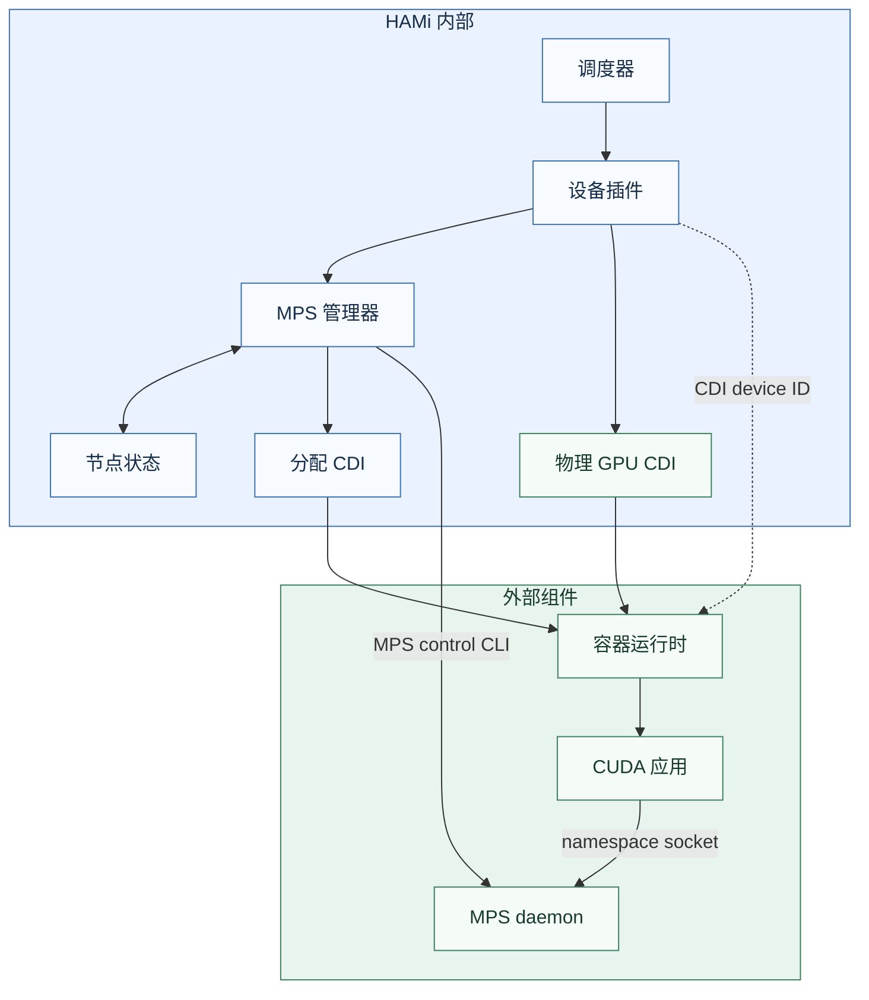
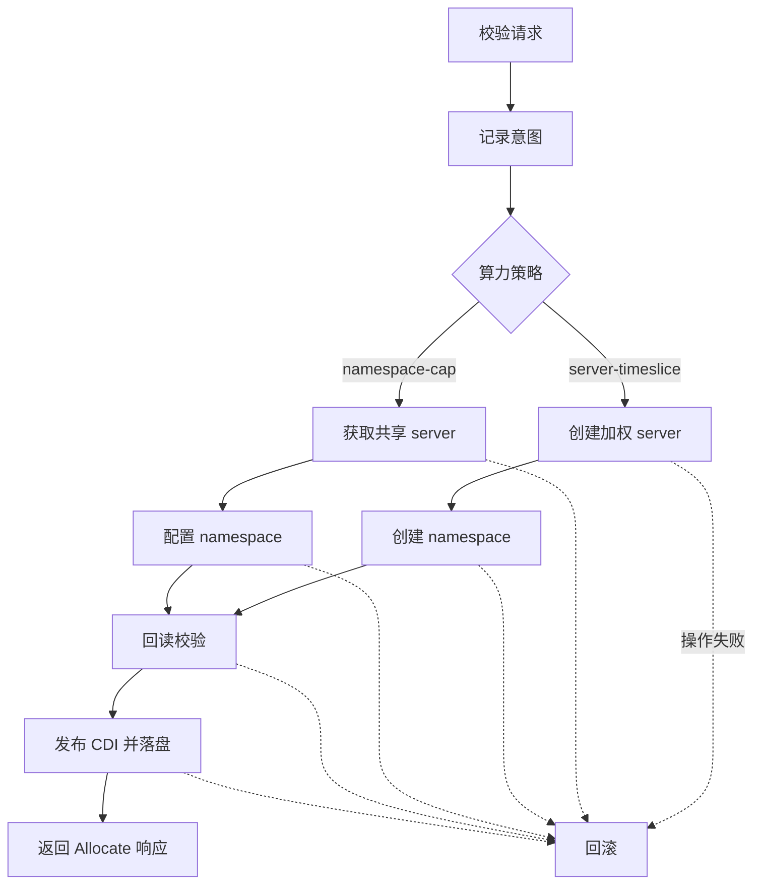

HAMi 使用 NVIDIA Container Toolkit 的 `apply-cuda-memory-limits` CDI hook 限制 GPU 显存，并通过 MPS v3 共享算力。后端以 r620 为最低驱动版本，启动时检查专用 daemon 的命令接口。部署和工作负载示例见[用户指南](../userguide/nvidia-device/mps-v3.md)。

## 架构

调度器匹配节点策略并核算每卡额度。设备插件读取分配注解，由 MPS 管理器验证资源归属，并在节点上记录分配意图和完成状态。HAMi 生成每次分配的专属 CDI，提供只读 socket 挂载、路由和显存环境变量。容器运行时应用其中的挂载和环境变量，CUDA 客户端通过挂载的 socket 连接 NVIDIA MPS namespace。设备插件调用 NVIDIA Container Toolkit 的库生成并发布物理 GPU CDI。该配置包含显存 hook，由容器运行时调用。

## 调度契约

设备插件上报 `mps-v3`、节点算力策略、SM 几何信息和已分配的 GPU 集合。调度器按 `hami.io/mps-compute-mode` 匹配节点策略，Pod 缺省为 `namespace-cap`。两种策略沿用每卡 100 单位的算力预算和现有配额。百分比或时间片请求的算力解析结果为 0 时，按 100 单位记账。

| 策略 | Server 身份 | 运行时配置 |
| --- | --- | --- |
| `namespace-cap` | 排序后的 GPU UUID 集合 | 每个 Pod UID 和容器名对应一个 namespace，设置活跃线程百分比或逐卡绑定静态分区。 |
| `server-timeslice` | Pod UID、容器名和排序后的 GPU UUID 集合 | 每个 GPU 容器使用独立 server。容器启动前写入并回读 `timeslice-pct`，namespace 百分比设为 100。 |

同一容器在每张卡上使用相同的显存和算力额度。相同 GPU 集合在 `namespace-cap` 下可共用 server，在 `server-timeslice` 下可运行多个独立 server。调度器和管理器均拒绝部分重叠的集合。同一 GPU 不能混用静态 SM 分区和 namespace 百分比。

静态分区以基础 SM 数核算。调度器校验每卡的 chunk 几何，并按 `ceil(基础 SM 数 / 总 SM 数 × 100)` 记账。开启借出或借入时，基础额度须由整 chunk 组成，有限峰值须覆盖基础额度并符合每卡容量。驱动在运行时决定借用量，调度预留保持基础额度。

## 分配与容器启动

### 分配流程

1. 校验 GPU 集合、策略、显存和算力设置。复用 server 前验证其归属。
2. 在创建资源前将稳定的资源名称和分配意图写入节点状态。
3. 创建或复用 server。新时间片 server 先设置权重，再创建 namespace。静态 SM 请求先按卡创建分区，再逐卡单独执行 `namespace set --device=<uuid> --sm-partition=<name>`。
4. 回读 GPU 集合、namespace 百分比、时间片权重和 SM 绑定，检查 socket。静态分区校验覆盖基础 chunks、余数、借出和借入选项。借用造成的有效 SM 数变化属于正常运行行为。
5. 发布专属 CDI 并持久化准备完成状态，再返回分配结果。请求内任一容器分配失败时，回滚本次新建的资源。

分配专属 CDI 提供只读 namespace socket 挂载、`CUDA_MPS_PIPE_DIRECTORY` 和整数 MiB 的 `NVIDIA_GPU_MEMORY_REQUEST`、`NVIDIA_GPU_MEMORY_LIMIT`。物理 GPU CDI 的 `createRuntime` hook 在应用启动前配置显存上限。服务端的静态分区绑定优先于客户端设置的分区标识。[NVIDIA namespace 绑定](https://docs.nvidia.com/deploy/mps/620/mpsv3-namespaces.html#sm-partition-assignments)

本版通过专属 namespace socket 路由算力。接入 cgroup 路由需要 Toolkit 提供正式接口，在容器启动前绑定真实 cgroup、重启时更新映射、退出时清理。绑定失败须阻止启动，并保留显存 hook 的正常执行。[NVIDIA cgroup 路由](https://docs.nvidia.com/deploy/mps/620/mpsv3-namespaces.html#cgroup-matching)

## Daemon、恢复与回收

管理器对专用状态目录加独占锁，在 `allocations.json` 记录版本、Pod 与容器身份、GPU 集合、额度、SM 选项、资源名称和准备状态。启动时根据权威节点 Pod 列表和 daemon 状态恢复分配。

排空后，管理器设置并核对 `compute-policy`。`server-timeslice` 节点用配置的 GPU 集合验证两个 server 能同时就绪。如果要恢复为默认 yield，管理器会在无 server 时重启 daemon。存在活跃分配时，管理器只核对既有策略和权重。daemon 级策略需要在没有 server 时变更，server 权重需要在没有客户端时变更。[NVIDIA 加权时间片接口](https://docs.nvidia.com/deploy/mps/620/mpsv3-interface.html#weighted-timeslicing)

健康检查和恢复优先使用 `get` 字段回读配置。资源是否存在、静态分区的具体设置通过 r620 CSV inventory 核对。620.70.06 的 `sm-partition list --all` 在状态列前还有一列 contract timeout。未知格式、查询超时或断连会停止当前操作并保留记录。daemon 或分配健康检查失败时，插件会上报设备不健康并阻止新分配。

恢复复用仍与记录一致的资源。遇到仍存活的旧版分配、策略不匹配或 daemon 丢失且仍有活跃分配时，管理器拒绝接管。仅重启管理器时，可以重新连接仍存活的 daemon。整个插件容器重启若同时结束了 daemon，则需要恢复受影响的工作负载。

回收依次执行非强制删除 namespace、删除分区、删除无引用 server，再移除 CDI 和状态。r620 会拒绝删除仍有客户端的 namespace，失败记录保留供重试。普通容器重启保留原分配，以便 kubelet 复用 Allocate 响应。
