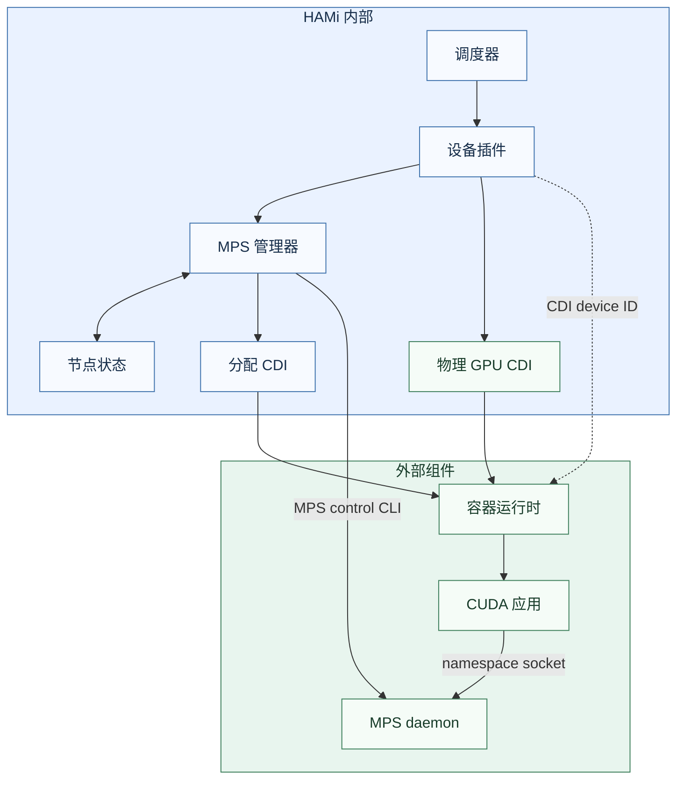
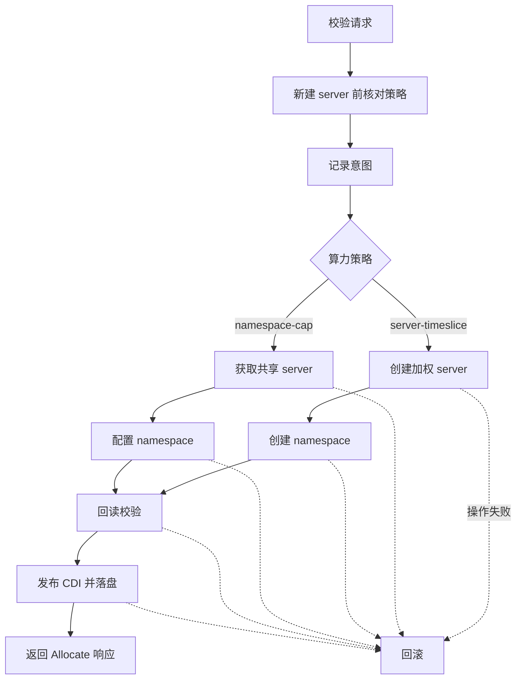

HAMi 使用 NVIDIA Container Toolkit 的 `apply-cuda-memory-limits` CDI hook 限制 GPU 显存，并通过 MPS v3 共享算力。目前后端仅支持 r620 驱动分支。部署和工作负载示例见[用户指南](../userguide/nvidia-device/mps-v3.md)。

## 架构

调度器匹配节点策略并核算每卡额度。设备插件读取分配注解，由 MPS 管理器验证资源归属，并在节点上记录分配意图和完成状态。HAMi 生成每次分配的专属 CDI，提供只读 socket 挂载、路由和显存环境变量。容器运行时应用其中的挂载和环境变量，CUDA 客户端通过挂载的 socket 连接 NVIDIA MPS namespace。设备插件调用 NVIDIA Container Toolkit 的库生成并发布物理 GPU CDI。该配置包含显存 hook，由容器运行时调用。

## 调度契约

`mps-v3` 模式直接序列化设备信息，保留 `CustomInfo` 中的算力策略、SM 几何和已分配 GPU 集合。调度器同时保留容器级 GPU 集合和 Pod 汇总用量。调度器按 `hami.io/mps-compute-mode` 匹配节点策略，Pod 缺省为 `namespace-cap`。两种策略沿用每卡 100 单位的算力预算和现有配额。百分比或时间片请求的算力解析结果为 0 时，按 100 单位记账。

| 策略 | Server 身份 | 运行时配置 |
| --- | --- | --- |
| `namespace-cap` | 排序后的 GPU UUID 集合 | 每个 Pod UID 和容器名对应一个 namespace，设置活跃线程百分比或逐卡绑定静态分区。 |
| `server-timeslice` | Pod UID、容器名和排序后的 GPU UUID 集合 | 每个 GPU 容器使用独立 server。容器启动前写入并回读 `timeslice-pct`，namespace 百分比设为 100。 |

同一容器在每张卡上使用相同的显存和算力额度。相同 GPU 集合在 `namespace-cap` 下可共用 server，在 `server-timeslice` 下可运行多个独立 server。调度器和管理器均拒绝部分重叠的集合。同一 GPU 不能混用静态 SM 分区和 namespace 百分比。

静态分区以基础 SM 数核算。创建静态分区前，管理器核对驱动报告的总 SM 数和 chunk 数。调度器按 `ceil(基础 SM 数 / 总 SM 数 × 100)` 记账。开启借出或借入时，基础额度须由整 chunk 组成，有限峰值须覆盖基础额度并符合每卡容量。驱动在运行时决定借用量，调度预留保持基础额度。

## 分配与容器启动

### 分配流程

1. 校验 GPU 集合、策略、显存和算力设置。复用 server 前验证其归属。
2. 如需新建 server，先核对 daemon 的 compute policy。创建分配资源前，将资源名称和分配意图写入节点状态。
3. 创建或复用 server。新时间片 server 先设置权重，再创建 namespace。静态 SM 请求先按卡创建分区，再逐卡单独执行 `namespace set --device=<uuid> --sm-partition=<name>`。
4. 回读 GPU 集合、namespace 百分比、时间片权重和 SM 绑定，检查 socket。静态分区校验覆盖基础 chunks、余数、借出和借入选项。借用造成的有效 SM 数变化属于正常运行行为。
5. 发布专属 CDI 并持久化准备完成状态，再返回分配结果。请求内任一容器分配失败时，回滚本次新建的资源。

分配专属 CDI 提供只读 namespace socket 挂载、`CUDA_MPS_PIPE_DIRECTORY` 和整数 MiB 的 `NVIDIA_GPU_MEMORY_REQUEST`、`NVIDIA_GPU_MEMORY_LIMIT`。物理 GPU CDI 的 `createRuntime` hook 在应用启动前配置显存上限。对于每张 GPU，namespace 的 SM 分区绑定优先于客户端的 `CUDA_MPS_SM_PARTITION` 设置。[NVIDIA namespace 绑定](https://docs.nvidia.com/deploy/mps/620/mpsv3-namespaces.html#sm-partition-assignments)

本版通过专属 namespace socket 路由算力。接入 cgroup 路由需要 Toolkit 提供正式接口，在容器启动前绑定真实 cgroup、重启时更新映射、退出时清理。绑定失败须阻止启动，并保留显存 hook 的正常执行。[NVIDIA cgroup 路由](https://docs.nvidia.com/deploy/mps/620/mpsv3-namespaces.html#cgroup-matching)

显存环境变量给 hook 传递额度。Toolkit 在容器创建时读取 OCI 配置，定位实际的容器 cgroup，并通过 NVML 按 GPU UUID 应用显存额度。HAMi 启动时校验物理 GPU 的 CDI 条目是否包含该 hook。显式选择 MPS v3 的 GPU 容器在 webhook 阶段会被拒绝设置保留的 `CUDA_MPS_*` 和 `NVIDIA_GPU_MEMORY_*` 环境变量。分配阶段也会检查显式环境变量。

管理命令通过 r620 的 v3 接口执行。静态分区使用 v3 的 chunk 规格并显式申请余数 SM，由 namespace 按卡绑定分区名。`CUDA_MPS_PIPE_DIRECTORY` 是两种协议共用的变量，在 v3 下可直接选择 namespace 的 socket 目录。 [NVIDIA 静态分区](https://docs.nvidia.com/deploy/mps/620/when-to-use-mps.html#static-sm-partitioning) · [NVIDIA namespace 路由](https://docs.nvidia.com/deploy/mps/620/mpsv3-namespaces.html#namespace-routing)

## Daemon、恢复与回收

管理器对专用状态目录加独占锁，在 `allocations.json` 记录版本、Pod 与容器身份、GPU 集合、额度、SM 选项、资源名称和准备状态。启动时根据权威节点 Pod 列表和 daemon 状态恢复分配。

插件启动时检查 daemon 的 compute policy。创建新 server 前会再次核对基础时间片和 yield。仅当值发生漂移且 daemon 没有任何 server 时，HAMi 才重新应用策略并回读。已有 server 时，配置不符会使该次分配失败。r620 只允许显式设置 yield 为 `1` 或 `2`。要恢复到 `unset`，须排空并重启外部 daemon，同时省略其启动配置中的 yield。 [NVIDIA 加权时间片](https://docs.nvidia.com/deploy/mps/620/mpsv3-interface.html#weighted-timeslicing)

`namespace-cap` 的活跃线程百分比限制已接入 namespace 的 CUDA client context，调度器按容器记账。对未设置 `EXCLUSIVE_PROCESS` 的 GPU，插件通过 NVML 发现后只告警。MPS server 持卡期间，`EXCLUSIVE_PROCESS` 可阻止其他进程直接创建独立 CUDA context。`server-timeslice` 只接纳使用 `DEFAULT` 的 GPU，时间片权重作用于 MPS server。计算模式由节点管理员设置。

后台对账每 5 秒尝试执行一轮。它用一次只读查询检查 daemon 连通性，连续三次查询失败会将 MPS GPU 标记为不健康。单个分配的健康检查失败只影响该分配的 GPU。设备上报读取最近一次成功落盘的只读快照，无需等待分配或清理中的 MPS CLI 调用。分配意图和清理失败的记录继续保留 GPU 归属。

配置检查优先使用 `get` 字段。资源是否存在和静态分区属性仍通过 r620 CSV 查询。静态分区解析按 620.70.06 的 `sm-partition list --all` 输出校验，要求状态列前有 contract timeout 列。未知格式会使受影响的操作报错并保留已有记录。

HAMi 在插件启动时关闭 daemon 主 socket 的 UID 自动建 server 功能。外部 daemon 重启后会恢复其启动配置。部署时应通过 daemon 的 TOML 文件设置 `default_socket = "off"`，以便每次启动都禁用这条 v2 兼容路由。 [NVIDIA v3 配置文件](https://docs.nvidia.com/deploy/mps/620/mpsv3-configuration-file.html)

恢复复用仍与记录一致的资源。遇到未知的状态版本、策略不匹配或 daemon 无法连接时，管理器拒绝启动。单个分配的资源缺失或配置不一致时，保留分配记录并将对应 GPU 标记为不健康。仅重启管理器时，可以重新连接仍存活的 daemon。daemon 由宿主机服务托管，插件重启后重新连接。如果宿主机 daemon 重启，导致已有分配的 server、namespace 或 SM 分区丢失，下一次分配健康检查会将该分配的 GPU 标记为不健康。通过 Kubernetes 恢复受影响的工作负载。

管理器用 Pod 缓存筛选待回收分配，并在回收已准备好的分配前通过 API Server 确认 Pod 已终止或不存在。管理器先持久化清理意图，确认 namespace 已删除后再清除准备完成标志。回收依次执行非强制删除 namespace、删除分区、删除无引用 server，再移除 CDI 和状态。r620 会拒绝删除仍有客户端的 namespace，失败记录保留供重试。普通容器重启保留原分配，以便 kubelet 复用 Allocate 响应。
