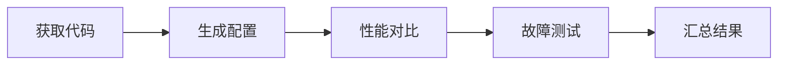

## 核心环境

| 项目       | 配置                                                         |
| ---------- | ------------------------------------------------------------ |
| GPU 与系统 | 2× A100-SXM4-40GB；Ubuntu 24.04.5；驱动 615.71.10；CUDA 13.4 |
| Kubernetes | 单节点 K3s 1.37.1                                            |
| 推理与模型 | Dynamo 1.6.1、vLLM 0.31.0；Qwen3-4B BF16                     |
| 对比方案   | HAMi 2.10.0；KAI 0.18.6 + GPU Fractioning 0.1.8              |
| 压测工具   | AIPerf 0.13.0；Python 3.11–3.13                              |

平台与模型缓存按 [Dynamo 部署指南](https://github.com/ai-dynamo/dynamo/tree/v1.6.1/examples/gpu-sharing)准备；共享方案使用 [HAMi chart](https://github.com/Project-HAMi/HAMi/tree/v2.10.0/charts/hami) 或 [GPU Fractioning](https://github.com/kai-scheduler/gpu-fractioning/tree/v0.1.8)。

## 测试流程



### 1. 获取代码

```bash
git clone https://github.com/Project-HAMi/gpu-sharing-benchmarks.git
cd gpu-sharing-benchmarks
python3 -m venv .venv
source .venv/bin/activate
pip install aiperf==0.13.0
```

### 2. 生成配置

复制 `config.example.json` 为 `config.json`，填写节点名、两个 GPU UUID 和模型缓存路径。默认配置不限算力，另生成 HAMi 50% 配置：

```bash
cp config.example.json config.json
# 填写 config.json 后执行：
python3 prepare.py --config config.json --out /var/tmp/hami-sharing-run
jq '.namespace_prefix = "sharing-bench-50pct"' config.json > config.50pct.json
python3 prepare.py --config config.50pct.json --out /var/tmp/hami-sharing-50pct --hami-core-limit 50
```

### 3. 性能对比

依次启用对应平台后运行。HAMi 节点标记 `gpu=on`，两套设备插件轮流启用。独立 MPS 和故障测试需免密 `sudo`。每条命令均包含 Graph 和 Eager：

```bash
# 原生 NVIDIA 插件：单实例、双实例
python3 reproduce.py --root /var/tmp/hami-sharing-run --profile fullstack --case native-default --case native-eager
python3 reproduce.py --root /var/tmp/hami-sharing-run --profile native-pair-fullstack

# HAMi 不限算力：安装 platform/hami-fullstack-values.yaml
python3 reproduce.py --root /var/tmp/hami-sharing-run --profile fullstack --case hami-default --case hami-eager
python3 reproduce.py --root /var/tmp/hami-sharing-run --profile controlled

# HAMi 50%：安装 platform/hami-50pct-values.yaml
python3 reproduce.py --root /var/tmp/hami-sharing-50pct --profile fullstack --case hami-default --case hami-eager
python3 reproduce.py --root /var/tmp/hami-sharing-50pct --profile controlled --case hami-pair-graph --case hami-pair-eager

# KAI + GPU Fractioning：default-queue 队列，sm-sharing 模式
python3 reproduce.py --root /var/tmp/hami-sharing-run --profile fullstack --case fractions-default --case fractions-eager

# 停止 GPU Fractioning，运行独立 MPS 对照
python3 reproduce.py --root /var/tmp/hami-sharing-run --profile mps-controlled
```

### 4. 故障测试

停止推理负载和共享服务，先运行原生/MPS 测试，再切换到 HAMi：

```bash
python3 reproduce.py --root /var/tmp/hami-sharing-run --profile fault
# 安装 platform/hami-fullstack-values.yaml，切换到 HAMi 不限算力配置
python3 reproduce.py --root /var/tmp/hami-sharing-run --profile hami-fault
```

### 5. 汇总结果

```bash
for profile in fullstack controlled mps-controlled native-pair-fullstack; do
  python3 summarize_metrics.py --root /var/tmp/hami-sharing-run/$profile --out /var/tmp/hami-sharing-run/$profile.csv
done
for profile in fullstack controlled; do
  python3 summarize_metrics.py --root /var/tmp/hami-sharing-50pct/$profile --out /var/tmp/hami-sharing-50pct/$profile.csv --allow-partial
done
```

性能结果输出为 CSV；故障结果见各故障目录的 `aggregate.json` 和 `conditions.csv`。对比数据与结论见[测试报告](./gpu-sharing-benchmarks.md)。
