The captured output comes from Kubernetes 1.35.2, CRI-O 1.35.1, NVIDIA driver 595.91.07, and HAMi 2.10.0 on a node with two 24 GiB NVIDIA A30 GPUs.

## What You'll Learn

## Lab Overview

```mermaid
%% title: HAMi and Last9 Lab Flow
flowchart LR
    Step1["Step 1<br/>Prepare Last9"] --> Step2["Step 2<br/>Install Prometheus Agent"]
    Step2 --> Step3["Step 3<br/>Install HAMi"]
    Step3 --> Step4["Step 4<br/>Check metrics endpoints"]
    Step4 --> Step5["Step 5<br/>Verify series in Last9"]
    Step5 --> Step6["Step 6<br/>Share one GPU"]
    Step6 --> Step7["Step 7<br/>Query allocated vs. used"]
    Step7 --> Step8["Step 8<br/>Trigger the memory alert"]
```



## Prerequisites

- A Kubernetes cluster with at least one NVIDIA GPU node. The verified environment uses one node with two 24 GiB A30 GPUs.
- NVIDIA driver and NVIDIA Container Toolkit on the GPU node, with an `nvidia` RuntimeClass. No other NVIDIA device plugin may run on the node, because HAMi registers the GPUs itself.
- A Last9 account. The free plan is enough.
- `kubectl`, Helm, and `jq`.
- The manifests from [`tutorials/labs/examples/22-last9-monitoring/`](https://github.com/Project-HAMi/website/tree/master/tutorials/labs/examples/22-last9-monitoring).

## Step 1: Prepare Last9

Last9 accepts Prometheus remote write and answers PromQL through a Prometheus-compatible read API. The lab needs four values from your Last9 Prometheus integration: the remote write URL, the read URL, a username, and a password.

Export them in the shell, and store the credentials in a Secret that Prometheus Agent reads in Step 2:

```bash
export LAST9_WRITE_URL='<remote write URL>'
export LAST9_READ_URL='<read URL>'
export LAST9_USER='<username>'
export LAST9_PASSWORD='<password>'

kubectl create namespace monitoring
kubectl -n monitoring create secret generic last9-remote-write \
  --from-literal=username="$LAST9_USER" \
  --from-literal=password="$LAST9_PASSWORD"
```

## Step 2: Install Prometheus Agent

Prometheus Agent scrapes targets and forwards samples with remote write, without storing or querying them locally. That is all this lab needs, because Last9 stores and queries the data.

Install it with the kube-prometheus-stack chart in agent mode. The chart also installs Prometheus Operator and its CRDs. Install it before HAMi: Helm only renders the HAMi ServiceMonitors when the `ServiceMonitor` CRD already exists, and skips them without an error otherwise.

[`01-kube-prometheus-stack-values.yaml`](https://github.com/Project-HAMi/website/blob/master/tutorials/labs/examples/22-last9-monitoring/01-kube-prometheus-stack-values.yaml) sets:

| Value | Why |
| --- | --- |
| `prometheus.agentMode: true` | Runs Prometheus as an agent. The chart creates the `PrometheusAgent` and its ServiceAccount and RBAC. |
| `serviceMonitorSelector` on `app.kubernetes.io/instance: hami` | Scrapes only the HAMi ServiceMonitors that Step 3 creates. |
| `externalLabels` `cluster: hami-lab` | Tells this cluster's series apart from others in the same Last9 account. |
| `remoteWrite` with `writeRelabelConfigs` keeping `hami_.*` | Sends only HAMi series to Last9, which keeps the series count small. |
| `alertmanager`, `grafana`, `kubeStateMetrics`, `nodeExporter`, `kubernetesServiceMonitors`, `defaultRules` turned off | Last9 stores and alerts on the data, and the lab uses HAMi metrics only. |

Install the chart, filling in the remote write URL from the shell variable:

```bash
helm repo add prometheus-community https://prometheus-community.github.io/helm-charts
helm repo update prometheus-community
envsubst < tutorials/labs/examples/22-last9-monitoring/01-kube-prometheus-stack-values.yaml \
  | helm install kube-prometheus-stack prometheus-community/kube-prometheus-stack \
      --version 92.11.0 -n monitoring -f -
kubectl -n monitoring rollout status deploy/kube-prometheus-stack-operator --timeout=180s
kubectl -n monitoring rollout status statefulset/prom-agent-kube-prometheus-stack-prometheus --timeout=180s
```

Check that the agent is running:

```bash
kubectl -n monitoring get pods
```

The agent has no targets yet. It picks up the HAMi ServiceMonitors as soon as Step 3 creates them.

## Step 3: Install HAMi

HAMi only runs its device plugin on nodes labeled `gpu=on`. Label the GPU node:

```bash
kubectl label node a30-node gpu=on
```

Install the HAMi 2.10.0 chart:

```bash
helm repo add hami-charts https://project-hami.github.io/HAMi/
helm repo update hami-charts
helm install hami hami-charts/hami --version 2.10.0 -n kube-system \
  --set devicePlugin.runtimeClassName=nvidia \
  --set prometheus.enabled=true
```

| Value | Why |
| --- | --- |
| `devicePlugin.runtimeClassName=nvidia` | The chart default is empty, so the device plugin would run with the node's default runtime. Without the NVIDIA runtime it cannot load NVML. |
| `prometheus.enabled=true` | Creates one ServiceMonitor for the scheduler and one for the vGPU monitor. The Prometheus Agent from Step 2 scrapes HAMi through them. |

Check that both Pods are running:

```bash
kubectl -n kube-system get pods -l app.kubernetes.io/instance=hami
```

```plaintext
NAME                              READY   STATUS    RESTARTS   AGE
hami-device-plugin-tk6pk          2/2     Running   0          3m37s
hami-scheduler-5dd7c74c8b-wl64h   2/2     Running   0          3m37s
```

Each Pod has two containers. The scheduler Pod runs kube-scheduler and the HAMi scheduler extender. The device plugin Pod runs the device plugin and the vGPU monitor.

Check that HAMi registered the GPUs:

```bash
kubectl get node a30-node -o jsonpath='{.metadata.annotations.hami\.io/node-nvidia-register}' \
  | jq -c '.[] | {id, type, devmem, devcore, count, mode, health}'
kubectl get node a30-node -o jsonpath='{.status.allocatable.nvidia\.com/gpu}{"\n"}'
```

```plaintext
{"id":"GPU-26e02ca7-f4ba-b335-915c-2a8541deb8a4","type":"NVIDIA A30","devmem":24576,"devcore":100,"count":10,"mode":"hami-core","health":true}
{"id":"GPU-a4d27439-566b-841c-428f-d87e73e4134e","type":"NVIDIA A30","devmem":24576,"devcore":100,"count":10,"mode":"hami-core","health":true}
20
```

Both A30s are registered in `hami-core` mode. The node reports 20 allocatable `nvidia.com/gpu` because the default split count lets up to 10 Pods share each card.

Check the metrics Services and ServiceMonitors:

```bash
kubectl -n kube-system get svc,servicemonitor -l app.kubernetes.io/instance=hami
```

```plaintext
NAME                                 TYPE       CLUSTER-IP       EXTERNAL-IP   PORT(S)                         AGE
service/hami-device-plugin-monitor   NodePort   10.99.71.176     <none>        31992:31992/TCP                 3m38s
service/hami-scheduler               NodePort   10.104.216.171   <none>        443:31998/TCP,31993:31993/TCP   3m38s

NAME                                                                      AGE
servicemonitor.monitoring.coreos.com/hami-device-plugin-metrics-monitor   3m38s
servicemonitor.monitoring.coreos.com/hami-scheduler-metrics-monitor       3m38s
```

The scheduler serves allocation metrics on `31993`, and the vGPU monitor serves usage metrics on `31992`. If the ServiceMonitors are missing, the Prometheus Operator CRDs did not exist when Helm rendered the chart.

Per-Pod metrics such as `hami_vgpu_memory_used_bytes` carry their own `pod`, `namespace`, and `container` labels. These clash with the labels Prometheus adds for the scrape target, and the HAMi 2.10.0 ServiceMonitors do not set `honorLabels`, so Prometheus would rename the workload labels to `exported_pod`, `exported_namespace`, and `exported_container`. Patch both ServiceMonitors to keep the workload labels:

```bash
for sm in hami-scheduler-metrics-monitor hami-device-plugin-metrics-monitor; do
  kubectl -n kube-system patch servicemonitor "$sm" --type=json \
    -p '[{"op":"add","path":"/spec/endpoints/0/honorLabels","value":true}]'
done
```

:::note

[HAMi PR #2934](https://github.com/Project-HAMi/HAMi/pull/2934) sets `honorLabels: true` in the chart after 2.10.0. On 2.10.0, a later `helm upgrade` of HAMi resets the ServiceMonitors, so run the patch again after each upgrade.

:::

## Step 4: Check the HAMi Metrics Endpoints

Read both endpoints directly to see what Prometheus Agent scrapes. This is the baseline with no GPU workload running.

```bash
export NODE_IP=$(kubectl get node a30-node \
  -o jsonpath='{.status.addresses[?(@.type=="InternalIP")].address}')
```

The scheduler on `31993` reports what HAMi has **allocated** to Pods:

```bash
curl -s http://$NODE_IP:31993/metrics \
  | grep -E '^hami_(gpu_memory_limit_bytes|gpu_memory_allocated_bytes|gpu_shared_count)'
```

```plaintext
hami_gpu_memory_allocated_bytes{device_cores="100",device_index="0",device_type="NVIDIA A30",device_uuid="GPU-26e02ca7-f4ba-b335-915c-2a8541deb8a4",node="a30-node",zone="vGPU"} 0
hami_gpu_memory_allocated_bytes{device_cores="100",device_index="1",device_type="NVIDIA A30",device_uuid="GPU-a4d27439-566b-841c-428f-d87e73e4134e",node="a30-node",zone="vGPU"} 0
hami_gpu_memory_limit_bytes{device_index="0",device_type="NVIDIA A30",device_uuid="GPU-26e02ca7-f4ba-b335-915c-2a8541deb8a4",node="a30-node",zone="vGPU"} 2.5769803776e+10
hami_gpu_memory_limit_bytes{device_index="1",device_type="NVIDIA A30",device_uuid="GPU-a4d27439-566b-841c-428f-d87e73e4134e",node="a30-node",zone="vGPU"} 2.5769803776e+10
hami_gpu_shared_count{device_index="0",device_type="NVIDIA A30",device_uuid="GPU-26e02ca7-f4ba-b335-915c-2a8541deb8a4",node="a30-node",zone="vGPU"} 0
hami_gpu_shared_count{device_index="1",device_type="NVIDIA A30",device_uuid="GPU-a4d27439-566b-841c-428f-d87e73e4134e",node="a30-node",zone="vGPU"} 0
```

Each A30 has 24576 MiB (`2.5769803776e+10` bytes), nothing is allocated yet, and no Pod shares either card.

The vGPU monitor on `31992` reports what the GPUs actually **use**:

```bash
curl -s http://$NODE_IP:31992/metrics \
  | grep -E '^hami_host_gpu_(memory_used_bytes|utilization_ratio)'
```

```plaintext
hami_host_gpu_memory_used_bytes{device_index="0",device_type="NVIDIA-NVIDIA A30",device_uuid="GPU-26e02ca7-f4ba-b335-915c-2a8541deb8a4",node="a30-node",zone="vGPU"} 4.31751168e+08
hami_host_gpu_memory_used_bytes{device_index="1",device_type="NVIDIA-NVIDIA A30",device_uuid="GPU-a4d27439-566b-841c-428f-d87e73e4134e",node="a30-node",zone="vGPU"} 4.31751168e+08
hami_host_gpu_utilization_ratio{device_index="0",device_type="NVIDIA-NVIDIA A30",device_uuid="GPU-26e02ca7-f4ba-b335-915c-2a8541deb8a4",node="a30-node",zone="vGPU"} 0
hami_host_gpu_utilization_ratio{device_index="1",device_type="NVIDIA-NVIDIA A30",device_uuid="GPU-a4d27439-566b-841c-428f-d87e73e4134e",node="a30-node",zone="vGPU"} 0
```

Each card already uses about 412 MiB with no Pod on it. That is the driver's own reservation, so remember it when you compare host usage with Pod usage later. The per-Pod series (`hami_vgpu_*` and `hami_container_*`) appear only after Step 6 starts GPU workloads.

> On a cluster with several GPU nodes, the `31992` NodePort returns the metrics of a random node on each request. Prometheus avoids this because the ServiceMonitor scrapes every device plugin Pod directly.

## Step 5: Verify the Series in Last9

Check that the agent found both HAMi targets:

```bash
kubectl -n monitoring port-forward svc/kube-prometheus-stack-prometheus 9090 &
curl -s http://127.0.0.1:9090/api/v1/targets \
  | jq -r '.data.activeTargets[] | "\(.labels.job) \(.health)"'
```

Check that the series reached Last9 by querying its Prometheus-compatible read API:

```bash
curl -s -u "$LAST9_USER:$LAST9_PASSWORD" "$LAST9_READ_URL/api/v1/query" \
  --data-urlencode 'query=count by (job) ({__name__=~"hami_.*", cluster="hami-lab"})' \
  | jq -r '.data.result[] | "\(.metric.job) \(.value[1])"'
```

## Step 6: Run Two Pods That Share One GPU

[`02-gpu-workloads.yaml`](https://github.com/Project-HAMi/website/blob/master/tutorials/labs/examples/22-last9-monitoring/02-gpu-workloads.yaml) runs two Deployments, `gpu-workload-a` and `gpu-workload-b`, from the public `pytorch/pytorch` image. A short Python script in a ConfigMap holds `ALLOC_MIB` of GPU memory and runs matrix multiplications in a loop, so each Pod uses both memory and compute.

| Setting | Value | Why |
| --- | --- | --- |
| `nvidia.com/gpumem` | `4000` | Each Pod is allocated 4000 MiB. |
| `nvidia.com/gpucores` | `30` | Each Pod is allowed 30% of the GPU cores. |
| `ALLOC_MIB` | `1000` | Each Pod holds far less than it is allocated, which Step 7 makes visible. |
| `nvidia.com/use-gpuuuid` | the first A30's UUID | HAMi's default `spread` policy would put the two Pods on different cards. Pinning both to one UUID makes them share. |

Replace the UUID in both Deployments with one from Step 3, then apply:

```bash
kubectl apply -f tutorials/labs/examples/22-last9-monitoring/02-gpu-workloads.yaml
kubectl -n last9-lab wait --for=condition=Available deploy --all --timeout=600s
kubectl -n last9-lab get pods -o wide
```

The first start can take several minutes while the node pulls the PyTorch image.

Check that both Pods landed on the same card:

```bash
curl -s http://$NODE_IP:31993/metrics | grep -E '^hami_gpu_shared_count'
```

The first A30 should report `2` and the second `0`.

## Step 7: Query Allocated and Used GPU Resources in Last9

## Step 8: Trigger the GPU Memory Alert

## Troubleshooting

## Cleanup

## What This Lab Proved

## Next Steps

- Add scheduling failure views once `hami_scheduler_allocation_failures_total` ships in a HAMi release.
