import Tabs from '@theme/Tabs'; import TabItem from '@theme/TabItem';

This lab uses NVIDIA's **nvml-mock** library to simulate a high-end GPU node — 4 fake GB300 GPUs — inside a local **kind** cluster. You will install HAMi from its public Helm chart, then verify GPU scheduling features: sharing, memory/core limits, percentage-based memory requests, and multi-GPU allocation — all without physical hardware.

## What You'll Get

After completing this lab, you will have a local Kubernetes cluster with:

- **nvml-mock** making the node report 4 fake GB300 GPUs (`nvidia.com/gpu: 40` after HAMi slices each physical GPU into 10 virtual slots)
- **HAMi** v2.11.0 device-plugin and scheduler installed from the public Helm chart
- Pods verified for: single GPU, GPU sharing, memory/core limits, percentage-based memory, and multi-GPU allocation

:::note

No real CUDA runtime exists in this environment. Pods use `busybox` with `CUDA_DISABLE_CONTROL=true` to prevent HAMi's control library from attempting real device access. Runtime enforcement of memory and core limits still requires physical GPUs.

:::

## Installation Overview

The entire installation process consists of 9 steps:

```mermaid
%% title: Fake-GPU Scheduling Installation Overview
flowchart LR
    Step1["Step 1<br/>Create kind Cluster"] --> Step2["Step 2<br/>Deploy nvml-mock"]
    Step2 --> Step3["Step 3<br/>Deploy HAMi"]
    Step3 --> Step4["Step 4<br/>Verify GPU Resources"]
    Step4 --> Step5["Step 5<br/>Basic GPU Scheduling"]
    Step5 --> Step6["Step 6<br/>GPU Sharing"]
    Step6 --> Step7["Step 7<br/>Memory & Core Limits"]
    Step7 --> Step8["Step 8<br/>Percentage Memory"]
    Step8 --> Step9["Step 9<br/>Multi-GPU Allocation"]
```



| Step | Purpose | What It Solves |
| --- | --- | --- |
| Create kind Cluster | Bootstrap local Kubernetes | Provide test environment |
| Deploy nvml-mock | Simulate 4 fake GB300 GPUs | Enable GPU discovery without hardware |
| Deploy HAMi | Install scheduler and device-plugin from the public Helm chart | Enable GPU partitioning and scheduling |
| Verify GPU Resources | Check `nvidia.com/gpu: 40` | Confirm virtual GPU slots registered |
| Basic GPU Scheduling | Single-GPU Pod allocation | Verify basic scheduler functionality |
| GPU Sharing | Pack 3 Pods onto the same GPU | Test concurrent GPU access |
| Memory & Core Limits | Enforce `gpumem` and `gpucores` | Validate resource constraints |
| Percentage Memory | Request 30% GPU memory | Test percentage-based allocation |
| Multi-GPU Allocation | Single Pod with 2 GPUs | Verify multi-GPU binding |

## Prerequisites

<Tabs groupId="os">

<TabItem value="macos" label="macOS" default>

- macOS, Intel or Apple Silicon
- [Docker Desktop](https://www.docker.com/products/docker-desktop/) or [OrbStack](https://orbstack.dev/) installed and running
- [Homebrew](https://brew.sh/) available

Install prerequisites:

```bash
brew install kind kubectl helm
```

Verify versions:

```bash
kind version                     # 0.20+
kubectl version --client --short # 1.31+
helm version                     # 3.x
```

</TabItem>

<TabItem value="linux" label="Linux (Ubuntu)">

- Ubuntu 20.04 LTS or later, x86_64
- [Docker Engine](https://docs.docker.com/engine/install/ubuntu/) installed and running

Install prerequisites:

```bash
# kind
KIND_VERSION=v0.33.0
curl -Lo ./kind "https://kind.sigs.k8s.io/dl/${KIND_VERSION}/kind-linux-amd64"
chmod +x ./kind && sudo mv ./kind /usr/local/bin/kind

# kubectl
curl -LO "https://dl.k8s.io/release/$(curl -L -s https://dl.k8s.io/release/stable.txt)/bin/linux/amd64/kubectl"
sudo install -o root -g root -m 0755 kubectl /usr/local/bin/kubectl && rm kubectl

# Helm
curl https://raw.githubusercontent.com/helm/helm/main/scripts/get-helm-3 | bash
```

Verify versions:

```bash
kind version                     # 0.20+
kubectl version --client --short # 1.31+
helm version                     # 3.x
```

</TabItem>

</Tabs>

:::tip

Windows users Use [WSL2](https://learn.microsoft.com/en-us/windows/wsl/install) with Ubuntu and follow the Linux tab above.

:::

## Step 1: Create the kind Cluster

```bash
kind create cluster --name nvml-mock-test
```

## Step 2: Deploy nvml-mock

nvml-mock provides a fake `libnvidia-ml.so`, virtual `/dev/nvidia*` device nodes, and PCI topology entries so HAMi's device-plugin sees 4 GB300 GPUs on the node.

Both the container image (`ghcr.io/nvidia/nvml-mock`) and the Helm chart are published to the GitHub Container Registry by the [NVIDIA/k8s-test-infra](https://github.com/NVIDIA/k8s-test-infra) project, so there is nothing to clone or build.

### 2.1 Install via Helm

```bash
helm install nvml-mock oci://ghcr.io/nvidia/k8s-test-infra/chart/nvml-mock \
  --version 0.7.0 \
  --namespace nvml-mock --create-namespace \
  --wait
```

The chart's default profile is `gb300`: 4 GB300 GPUs per node with 284672 MiB (278 GiB) of memory each, driver version `580.65.06`, and a fake driver root at `/var/lib/nvml-mock/driver`. This driver root path is passed to HAMi in Step 4.

:::tip

To simulate a different GPU model, add `--set gpu.profile=<name>` (`a100`, `h100`, `b200`, `gb200`, `l40s`, `t4`, `vrnvl72`). The expected outputs in this lab assume the default `gb300` profile.

:::

### 2.2 Verify GPU Discovery

Run the mock `nvidia-smi` shipped in the nvml-mock Pod. If it reports `container not found`, the Pod is still starting, so retry after a few seconds:

```bash
kubectl -n nvml-mock exec daemonset/nvml-mock -- nvidia-smi -L
```

Expected output:

```plaintext
GPU 0: NVIDIA GB300 NVL (UUID: GPU-b300b300-0000-0000-0000-000000000000)
GPU 1: NVIDIA GB300 NVL (UUID: GPU-b300b300-0000-0000-0000-000000000001)
GPU 2: NVIDIA GB300 NVL (UUID: GPU-b300b300-0000-0000-0000-000000000002)
GPU 3: NVIDIA GB300 NVL (UUID: GPU-b300b300-0000-0000-0000-000000000003)
```

## Step 3: Deploy HAMi

HAMi is installed from its public Helm chart repository, so there is nothing to build.

### 3.1 Install via Helm

```bash
helm repo add hami-charts https://project-hami.github.io/HAMi/
helm repo update

helm install hami hami-charts/hami \
  --namespace hami-system \
  --create-namespace \
  --version 2.11.0 \
  --set devicePlugin.nvidiaDriverRoot=/var/lib/nvml-mock/driver \
  --set devicePlugin.nvidiaNodeSelector.gpu=null
```

- `devicePlugin.nvidiaDriverRoot` points HAMi at the fake driver libraries installed by nvml-mock.
- `devicePlugin.nvidiaNodeSelector.gpu=null` clears the chart's default `gpu=on` node selector, so the device-plugin runs on the node without labelling it first.

### 3.2 Verify the Rollout

```bash
kubectl -n hami-system rollout status daemonset/hami-device-plugin --timeout=120s
kubectl -n hami-system get pods -l app.kubernetes.io/name=hami
```

Expected output:

```plaintext
NAME                              READY   STATUS    RESTARTS   AGE
hami-device-plugin-7ln9b          2/2     Running   0          75s
hami-scheduler-7cc7557795-l7mh8   2/2     Running   0          78s
```

## Step 4: Verify GPU Resources

HAMi partitions each physical GPU into 10 virtual slots. With 4 physical GPUs the node should advertise **40** allocatable virtual GPUs.

```bash
kubectl get nodes \
  -o custom-columns='NODE:.metadata.name,GPU_CAPACITY:.status.capacity.nvidia\.com/gpu,GPU_ALLOCATABLE:.status.allocatable.nvidia\.com/gpu'
```

Expected output:

```plaintext
NODE                           GPU_CAPACITY   GPU_ALLOCATABLE
nvml-mock-test-control-plane   40             40
```

Both `GPU_CAPACITY` and `GPU_ALLOCATABLE` showing `40` confirms the device-plugin registered all virtual GPU slots on the node.

## Step 5: Test Basic GPU Scheduling

Deploy a minimal Pod requesting one GPU. `CUDA_DISABLE_CONTROL=true` prevents HAMi's injected CUDA shim from attempting real device access:

```bash
kubectl apply -f - <<'EOF'
apiVersion: v1
kind: Pod
metadata:
  name: gpu-test-1
spec:
  containers:
  - name: sleep
    image: busybox
    command: ["sleep", "3600"]
    env:
    - name: CUDA_DISABLE_CONTROL
      value: "true"
    resources:
      limits:
        nvidia.com/gpu: 1
EOF
```

Wait for the Pod to run:

```bash
kubectl get pod gpu-test-1 -w
```

Expected output:

```plaintext
NAME         READY   STATUS    RESTARTS   AGE
gpu-test-1   1/1     Running   0          4s
```

Verify the allocation annotation:

```bash
kubectl describe pod gpu-test-1 | grep vgpu-devices-allocated
```

Expected output:

```plaintext
hami.io/vgpu-devices-allocated: GPU-b300b300-0000-0000-0000-000000000003,NVIDIA,284672,100:;
```

> The annotation format is `<UUID>,<vendor>,<memMiB>,<cores>`. A GB300 GPU has 284672 MiB of memory, and because the Pod set no memory limit it was given the whole card. Seeing this annotation confirms one GPU was allocated and recorded by the scheduler. The GPU picked (the last digit of the UUID) may differ in your run.

## Step 6: Test GPU Sharing (Time-slicing)

Deploy three more Pods, each requesting 1 GPU with 20000 MiB of memory. The `hami.io/gpu-scheduler-policy: "binpack"` annotation tells the scheduler to pack them onto the same physical GPU instead of spreading them across cards:

```bash
for i in 2 3 4; do
kubectl apply -f - <<EOF
apiVersion: v1
kind: Pod
metadata:
  name: gpu-test-$i
  annotations:
    hami.io/gpu-scheduler-policy: "binpack"
spec:
  containers:
  - name: sleep
    image: busybox
    command: ["sleep", "3600"]
    env:
    - name: CUDA_DISABLE_CONTROL
      value: "true"
    resources:
      limits:
        nvidia.com/gpu: 1
        nvidia.com/gpumem: "20000"
EOF
done
```

:::warning

Use `<<EOF`, not `<<'EOF'` inside the loop Single-quoting the delimiter suppresses shell expansion. `$i` would not be substituted and all three Pods would get the same name.

:::

Verify all Pods are running:

```bash
kubectl get pods | grep gpu-test
```

Expected output:

```plaintext
gpu-test-1   1/1     Running   0          8m27s
gpu-test-2   1/1     Running   0          18s
gpu-test-3   1/1     Running   0          17s
gpu-test-4   1/1     Running   0          17s
```

Check which physical GPU each Pod was given:

```bash
kubectl get pods \
  -o custom-columns='POD:.metadata.name,ALLOCATED:.metadata.annotations.hami\.io/vgpu-devices-allocated'
```

Expected output:

```plaintext
POD          ALLOCATED
gpu-test-1   GPU-b300b300-0000-0000-0000-000000000003,NVIDIA,284672,100:;
gpu-test-2   GPU-b300b300-0000-0000-0000-000000000002,NVIDIA,20000,0:;
gpu-test-3   GPU-b300b300-0000-0000-0000-000000000002,NVIDIA,20000,0:;
gpu-test-4   GPU-b300b300-0000-0000-0000-000000000002,NVIDIA,20000,0:;
```

`gpu-test-2`, `gpu-test-3`, and `gpu-test-4` carry the same GPU UUID with a 20000 MiB slice each, so three Pods share one physical GPU, while `gpu-test-1` keeps its own card. The `0` in the last field means no compute limit was requested.

## Step 7: Test Memory and Core Limits

```bash
kubectl apply -f - <<'EOF'
apiVersion: v1
kind: Pod
metadata:
  name: gpu-limits
spec:
  containers:
  - name: sleep
    image: busybox
    command: ["sleep", "3600"]
    env:
    - name: CUDA_DISABLE_CONTROL
      value: "true"
    resources:
      limits:
        nvidia.com/gpu: 1
        nvidia.com/gpumem: "10"
        nvidia.com/gpucores: "30"
EOF
```

:::info

Resource Limits Format `nvidia.com/gpumem` takes an **absolute value in MiB** — `"10"` means 10 MiB. `nvidia.com/gpucores: "30"` requests 30% of the selected GPU's compute capacity.

:::

Verify the allocation:

```bash
kubectl describe pod gpu-limits | grep vgpu-devices-allocated
```

Expected output:

```plaintext
hami.io/vgpu-devices-allocated: GPU-b300b300-0000-0000-0000-000000000001,NVIDIA,10,30:;
```

The annotation records `10` MiB and `30` (30% of the GPU's compute capacity) — exactly the values requested.

## Step 8: Test Percentage-Based Memory Request

Instead of a fixed MiB value, `nvidia.com/gpumem-percentage` lets you request a fraction of the GPU's total memory. On a GB300 (284672 MiB), requesting 30% allocates 85401 MiB.

:::tip

Why Percentage-Based Allocation? This is useful when you want workloads to scale proportionally across different GPU models without hardcoding absolute sizes.

:::

Create the Pod:

```bash
kubectl apply -f - <<'EOF'
apiVersion: v1
kind: Pod
metadata:
  name: gpu-mem-30pct
spec:
  containers:
  - name: sleep
    image: busybox
    command: ["sleep", "3600"]
    env:
    - name: CUDA_DISABLE_CONTROL
      value: "true"
    resources:
      limits:
        nvidia.com/gpu: 1
        nvidia.com/gpumem-percentage: "30"
EOF
```

Wait for the Pod to reach `Running`:

```bash
kubectl get pod gpu-mem-30pct -w
```

Expected output:

```plaintext
NAME            READY   STATUS    RESTARTS   AGE
gpu-mem-30pct   1/1     Running   0          2s
```

Inspect the allocation annotation:

```bash
kubectl get pod gpu-mem-30pct \
  -o jsonpath='{.metadata.annotations.hami\.io/vgpu-devices-allocated}'
```

Expected output:

```plaintext
GPU-b300b300-0000-0000-0000-000000000000,NVIDIA,85401,0:;
```

> The third field shows `85401` MiB — 30% of 284672 MiB, rounded down — confirming the scheduler correctly translated the percentage into an absolute memory budget for the allocation.

## Step 9: Test Multi-GPU Allocation

Request 2 GPUs with 20000 MiB on each. The memory limit matters here: without it the Pod would need two completely free cards, and after the previous steps every one of the 4 GPUs already holds an allocation.

```bash
kubectl apply -f - <<'EOF'
apiVersion: v1
kind: Pod
metadata:
  name: gpu-multi
spec:
  containers:
  - name: sleep
    image: busybox
    command: ["sleep", "3600"]
    env:
    - name: CUDA_DISABLE_CONTROL
      value: "true"
    resources:
      limits:
        nvidia.com/gpu: "2"
        nvidia.com/gpumem: "20000"
EOF
```

Verify the Pod is running:

```bash
kubectl get pod gpu-multi
```

Expected output:

```plaintext
NAME        READY   STATUS    RESTARTS   AGE
gpu-multi   1/1     Running   0          2s
```

Check the scheduler events:

```bash
kubectl describe pod gpu-multi | tail -10
```

Expected output:

```plaintext
Events:
  Type    Reason            Age   From            Message
  ----    ------            ----  ----            -------
  Normal  Scheduled         2s    hami-scheduler  Successfully assigned default/gpu-multi to nvml-mock-test-control-plane
  Normal  FilteringSucceed  2s    hami-scheduler  find fit node(nvml-mock-test-control-plane), 0 nodes not fit, 1 nodes fit(nvml-mock-test-control-plane:8.53)
  Normal  BindingSucceed    2s    hami-scheduler  Successfully binding node [nvml-mock-test-control-plane] to default/gpu-multi
  Normal  Pulling           1s    kubelet         Pulling image "busybox"
  Normal  Pulled            0s    kubelet         Successfully pulled image "busybox" in 723ms (723ms including waiting). Image size: 1926012 bytes.
  Normal  Created           0s    kubelet         Container created
  Normal  Started           0s    kubelet         Container started
```

The `hami-scheduler` events — `FilteringSucceed`, `Scheduled`, and `BindingSucceed` — confirm HAMi's scheduler handled this Pod and successfully bound it to the node.

Inspect the allocation annotation:

```bash
kubectl get pod gpu-multi \
  -o jsonpath='{.metadata.annotations.hami\.io/vgpu-devices-allocated}'
```

Expected output:

```plaintext
GPU-b300b300-0000-0000-0000-000000000000,NVIDIA,20000,0:GPU-b300b300-0000-0000-0000-000000000001,NVIDIA,20000,0:;
```

The annotation holds two colon-separated device entries with different UUIDs, one per allocated GPU, each with a 20000 MiB slice.

## Summary of Verified Features

| Feature | Test Pod | How It Is Verified |
| --- | --- | --- |
| Basic GPU scheduling | `gpu-test-1` | Annotation shows 1 GPU UUID + 284672 MiB |
| GPU sharing (time-slicing) | `gpu-test-2` through `gpu-test-4` | All 3 annotations show the same GPU UUID |
| Memory limit (`gpumem`) | `gpu-limits` | Annotation shows `10` MiB |
| Compute limit (`gpucores`) | `gpu-limits` | Annotation shows `30` (30% of compute capacity) |
| Percentage memory (`gpumem-percentage`) | `gpu-mem-30pct` | Annotation shows `85401` MiB (30% of a GB300) |
| Multi-GPU allocation | `gpu-multi` | Annotation lists 2 GPU UUIDs; hami-scheduler events show `BindingSucceed` |

:::warning Real GPU required for the following

- Actual CUDA program execution
- Runtime enforcement of `gpumem` and `gpucores` limits
- Real DCGM GPU metrics (temperature, utilisation)
- Memory overcommit and memory override features

:::

## Cleanup

Delete all test Pods:

```bash
kubectl delete pod gpu-test-1 gpu-test-2 gpu-test-3 gpu-test-4 \
  gpu-limits gpu-mem-30pct gpu-multi
```

Uninstall HAMi:

```bash
helm uninstall hami -n hami-system
```

Uninstall nvml-mock:

```bash
helm uninstall nvml-mock -n nvml-mock
```

Delete the kind cluster:

```bash
kind delete cluster --name nvml-mock-test
```

:::tip

Skip the cluster deletion step if you want to keep the environment for further experimentation.

:::

## Next Steps

- Add GPU metrics without leaving the mock environment: the NVIDIA GPU Operator's `dcgm-exporter` can read the nvml-mock driver and feed Prometheus and Grafana (see the [nvml-mock observability setup](https://github.com/NVIDIA/k8s-test-infra/tree/main/local/observability)).
- Add Prometheus and HAMi WebUI for visual resource tracking (see [Lab 2: Local Fake GPU Setup](/tutorials/labs/local-fake-gpu)).
- Move to a real GPU cluster (see [Lab 1: Online HAMi Installation](/tutorials/labs/online-install)) to test memory and core isolation with actual CUDA workloads.
